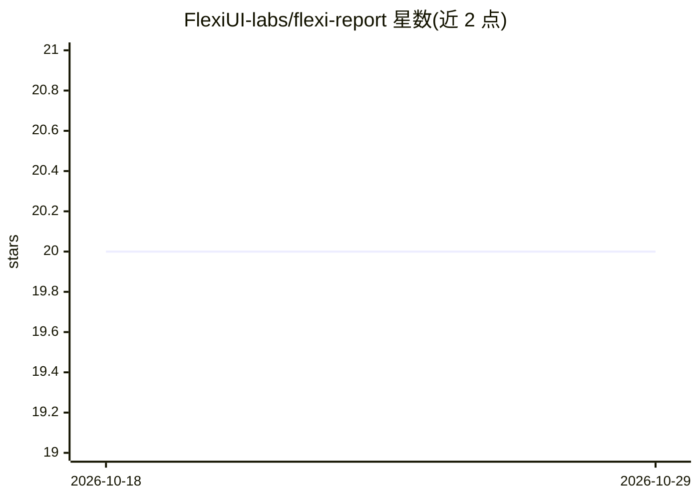

# FlexiUI-labs/flexi-report

⭐ 20 · TypeScript · 推送 2026-06-08 · [GitHub](https://github.com/FlexiUI-labs/flexi-report) · [官网](https://stackblitz.com/edit/stackblitz-starters-1e3ed8qu) · 组织维护

**Angular 报表组件：拖拽设计、数据绑定与 PDF/Excel 导出**

面向 Angular 开发者的独立（standalone）报表组件：支持动态添加与排版报表元素（表格、标题、图片、线条等）、样式面板控制字体颜色边距、表格页脚动态计算（求和/平均）。数据可绑定 API 端点或 SQL 查询填充，提供请求表单输入字段用于过滤。支持 A4/A5/A6 页面配置、拖拽重排（Angular CDK）、PDF/Excel/JSON 导入导出。AI 部分为通过 OpenAI API key 依据 schema 生成 SQL 查询。以 npm 包安装，MIT 许可。

## 筛选速览

| 维度 | 判定 | 备注 |
|---|---|---|
| AI 角色 | `ai-enhanced` | 去掉 AI 部分产品仍成立 |
| 许可风险 | `none` | — |
| 部署形态 | `library` | 以包/库形式分发 |
| 模型依赖 | — | README 未给出锁定关系 |
| 硬件要求 | — | 无带数字的原话,不猜 |
| 安装摩擦 | `low` | 无编译、无系统依赖或容器化 |
| 成熟度 | — | 结构信号不足 |

## 能力要点

- 拖拽重排表头与表单元素（Angular CDK DragDrop）
- SQL 查询执行与 API/SQL 数据绑定
- OpenAI 集成按 schema 生成 SQL 查询
- PDF/Excel/JSON 导出与页面配置（A4/A5/A6、横竖版）

## 适用场景

- 在 Angular 应用中嵌入可交互的报表设计器
- 通过请求表单过滤数据并导出 PDF/Excel 报表
- 用 AI 依据数据库 schema 生成 SQL 查询

## 场景标签

`数据分析` · 领域:效率与自动化

## 证据(README 行号)

> L3: Flexi Report is a dynamic Angular standalone component designed to easily create, style, and manage interactive repo
> L15: - **AI Integration**: Generate SQL queries using OpenAI integration for optimized database queries.

## 星数曲线

2026-10-18 20 → 2026-10-29 20（+0）

---
*卡片 v1 · prompt 1.4 · 生成 2026-10-28 · 置信度 high · 依据 README sha `8435dca4cf45` · [字段定义](../../DATASET.md)*
