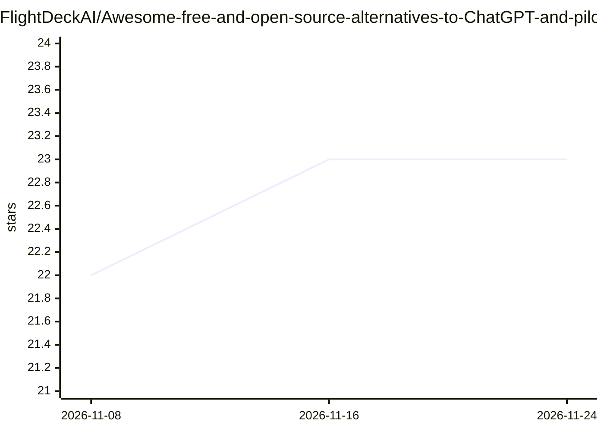

# FlightDeckAI/Awesome-free-and-open-source-alternatives-to-ChatGPT-and-pilot-training-courseware.-

⭐ 23 · Apache-2.0 · 推送 2026-11-05 · [GitHub](https://github.com/FlightDeckAI/Awesome-free-and-open-source-alternatives-to-ChatGPT-and-pilot-training-courseware.-) · [官网](http://www.federal.ai) · 个人维护

**开源 ChatGPT 替代品与飞行员训练资源的策展清单**

由 Lloyd Clark 维护的聚合清单，2023 年 4 月汇编，分两部分：语言模型项目（RLHF 实现、聊天界面、指令微调模型如 Stanford Alpaca、ChatGLM-6B、GPT4ALL、Cerebras-GPT 等）与航空工具（FlightGear 飞行模拟器、AeroNavMap 导航、OpenAeroStruct 结构分析、AirspaceConverter 数据转换）。条目描述反映汇编时期状态，README 提示读者访问上游链接确认现状与许可。不含安装命令。

## 筛选速览

| 维度 | 判定 | 备注 |
|---|---|---|
| AI 角色 | `ai-knowledge` | 知识聚合/清单类 |
| 许可风险 | `permissive` | Apache-2.0 |
| 部署形态 | `None` |  |
| 模型依赖 | — | README 未给出锁定关系 |
| 硬件要求 | — | 无带数字的原话,不猜 |
| 安装摩擦 | `low` | 无编译、无系统依赖或容器化 |
| 成熟度 | — | 结构信号不足 |

## 能力要点

- 收录约 15 个语言模型/训练项目，含 LLaMA 衍生项目分组
- 航空工具覆盖飞行模拟、导航、结构分析与空域数据转换
- 注明描述基于 2023 年 4 月，引导读者查阅上游链接

## 适用场景

- 查找 2023 年初期的开源 ChatGPT 替代项目
- 查找飞行员训练相关的开源工具
- 了解早期开源 LLM 生态的项目分布

## 场景标签

`精选清单` · 领域:学习与行业

## 证据(README 行号)

> L3: A collection of language model projects, local chat interfaces, and aviation tools, curated by Lloyd Clark.
> L5: Originally assembled in April 2023. The project descriptions below reflect that period. Follow the upstream links fo

## 星数曲线

2026-11-08 22 → 2026-11-24 23（+1）

---
*卡片 v1 · prompt 1.4 · 生成 2026-11-18 · 置信度 high · 依据 README sha `a2adb14affb4` · [字段定义](../../DATASET.md)*
