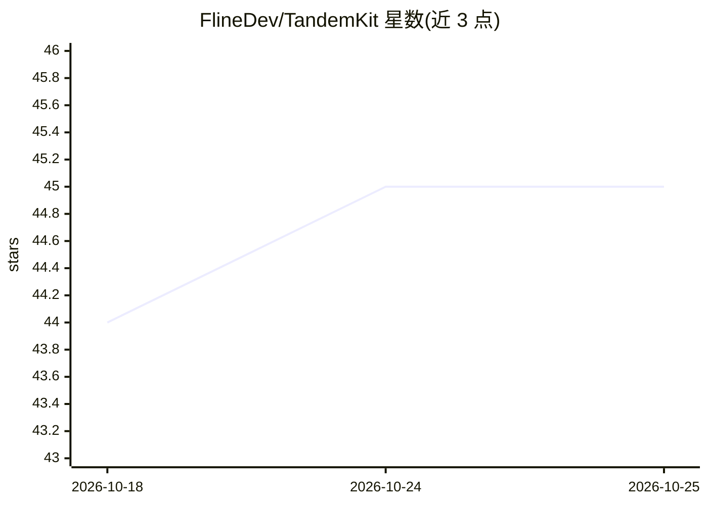

# FlineDev/TandemKit

⭐ 45 · Shell · MIT · 推送 2026-05-02 · [GitHub](https://github.com/FlineDev/TandemKit) · 个人维护

**Claude Code 插件：Planner/Generator/Evaluator 三会话协作开发**

面向持有 Claude Max 与 ChatGPT 订阅的开发者的 Claude Code 插件：将任务拆为 Planner（规划与规格确认）、Generator（自主实现）、Evaluator（独立验证）三个会话；Planner 与 Evaluator 中 Claude 会通过官方 Codex 插件在后台启动 Codex，两模型独立调查并按严重度迭代收敛，收敛失败 3 轮升级给用户裁决。用户仅在规格审批与最终评审两个节点介入。init 命令按项目类型（Apple/Android/Web/CLI/领域系统）配置构建、测试、截图等验证工具，角色文件可自定义。依赖 python3 与 watchman，多会话循环的 token 消耗高于普通会话。

## 筛选速览

| 维度 | 判定 | 备注 |
|---|---|---|
| AI 角色 | `ai-ecosystem` | LLM/agent 周边工具 |
| 许可风险 | `permissive` | MIT |
| 部署形态 | `None` |  |
| 模型依赖 | locked-api |  |
| 硬件要求 | — | 无带数字的原话,不猜 |
| 安装摩擦 | `medium` | 含编译或系统依赖之一 |
| 成熟度 | — | 结构信号不足 |

## 能力要点

- 三会话结构：Planner/Generator/Evaluator，仅在规格审批与最终评审需人工介入
- Claude 与 Codex 双模型独立调查、按严重度收敛、3 轮僵持升级用户裁决
- 按项目类型自动配置验证工具（XcodeBuildMCP、Android CLI、browser-use、测试套件等）
- 生成 TandemKit/ 目录下三个角色文件作为自定义点，含强化版 Evaluator 系统提示

## 适用场景

- 复杂开发任务让生成与验证分离、自主循环直到通过评估
- 利用两个不同模型的独立评审发现单一会话漏掉的缺陷
- 按项目类型为评估会话配置构建、运行、截图等具体验证手段

## 场景标签

`编码 Agent` `多智能体` · 领域:Agent 开发

## 证据(README 行号)

> L7: TandemKit is a Claude Code plugin that runs three sessions — Planner, Generator, and Evaluator — with two of them pa
> L25: All three sessions are Claude Code sessions. Claude orchestrates everything — including launching Codex as a backgr

## 星数曲线

2026-10-18 44 → 2026-10-25 45（+1）

---
*卡片 v1 · prompt 1.4 · 生成 2026-10-25 · 置信度 high · 依据 README sha `22e921c64def` · [字段定义](../../DATASET.md)*
