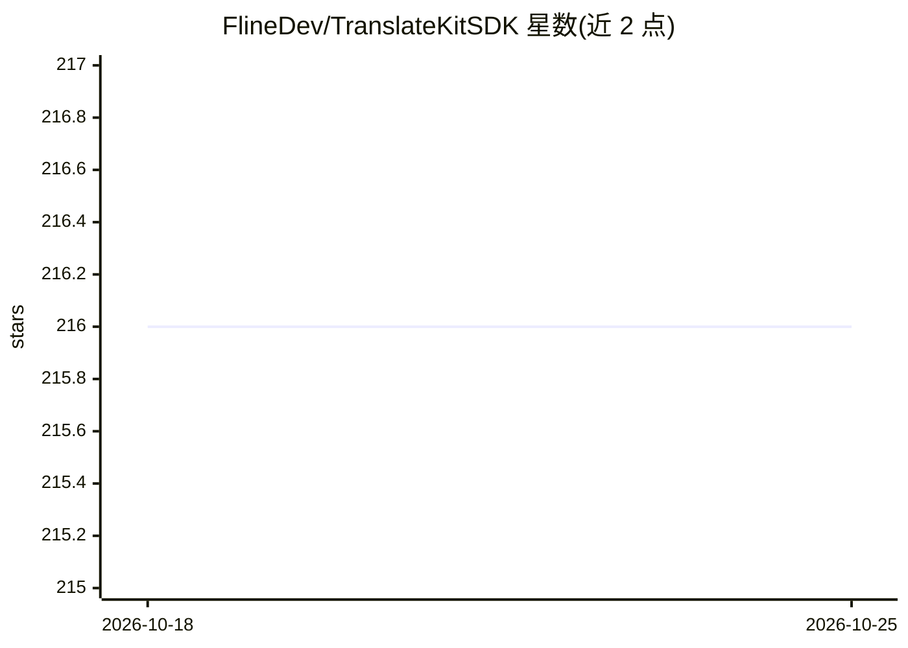

# FlineDev/TranslateKitSDK

⭐ 217 · Swift · MIT · 推送 2026-10-14 · [GitHub](https://github.com/FlineDev/TranslateKitSDK) · [官网](https://translatekit.app) · 个人维护

**Swift 应用预置本地化字符串 SDK：2000+ 条 40 语言**

面向 Apple 平台 Swift 开发者的本地化字符串库：提供 2,000+ 条覆盖约 40 种 iOS 系统语言的预翻译字符串，优先采用 Apple 官方系统翻译以保持与系统 UI 一致，直接以静态属性（如 TK.Action.save）调用，不写入 String Catalog。分为 250+ 条核心字符串与 26 个 App Store 类别的扩展模块（每类约 100 条，如 Finance/Productivity），按需导入对应模块即可，整体增加约 1MB。通过 Swift Package Manager 安装，包本身无依赖、无宏。2.0 版本移除了 1.x 的 #tk/#tkm 宏与 Lite 变体，迁移指南附带让 AI 助手转换宏调用的提示词。

## 筛选速览

| 维度 | 判定 | 备注 |
|---|---|---|
| AI 角色 | `ai-enhanced` | 去掉 AI 部分产品仍成立 |
| 许可风险 | `permissive` | MIT |
| 部署形态 | `None` |  |
| 模型依赖 | — | README 未给出锁定关系 |
| 硬件要求 | — | 无带数字的原话,不猜 |
| 安装摩擦 | `low` | 无编译、无系统依赖或容器化 |
| 成熟度 | — | 结构信号不足 |

## 能力要点

- 2,000+ 预翻译字符串，覆盖约 40 种 Apple 平台语言
- 采用 Apple 官方系统翻译，与系统 UI 文案一致
- 核心字符串 + 26 个 App Store 类别扩展模块的分层结构
- 包无依赖、无宏，通过 Swift Package Manager 安装

## 适用场景

- Swift 应用快速接入常用 UI 文案的多语言支持
- 避免为通用字符串（保存/取消等）手工维护翻译
- 按 App 类别（如财务、健康）导入领域定制文案

## 场景标签

 · 领域:移动开发/本地化工具

## 证据(README 行号)

> L7: Eliminate localization overhead in your Swift apps with 2000+ pre-localized strings. Make app localization simple, a
> L12: Access 2,000+ ready-to-use strings in ~40 Apple platform languages across four categories. These match the official

## 星数曲线

2026-10-18 216 → 2026-10-25 216（+0）

---
*卡片 v1 · prompt 1.4 · 生成 2026-10-22 · 置信度 mid · 依据 README sha `ee2e0f80faa5` · [字段定义](../../DATASET.md)*
