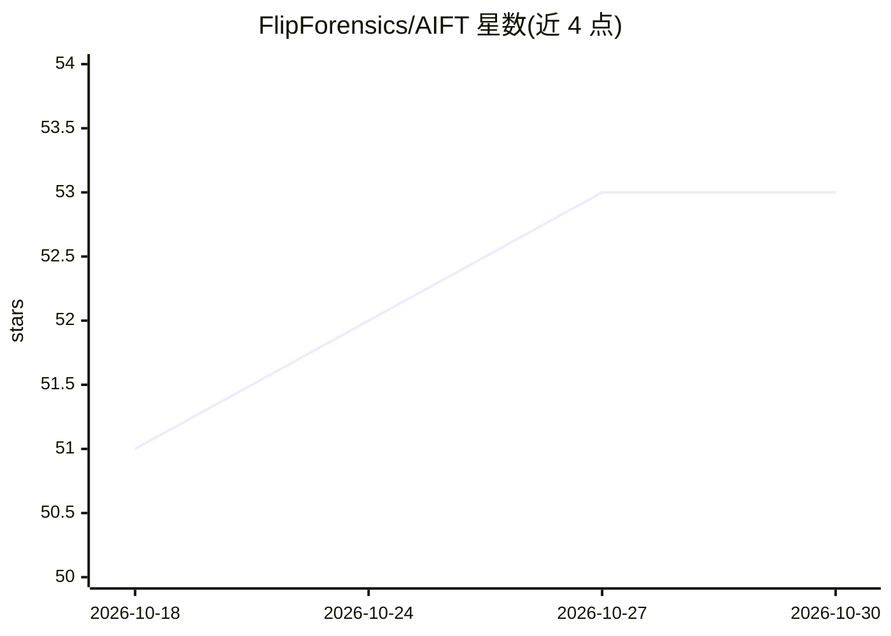

# FlipForensics/AIFT

⭐ 53 · Python · AGPL-3.0 · 推送 2026-06-13 · [GitHub](https://github.com/FlipForensics/AIFT) · [官网](https://github.com/FlipForensics/AIFT/wiki) · 组织维护

**面向 DFIR 分析师的取证初筛工具，AI 解析证据生成线索报告**

AIFT 是数字取证与事件响应（DFIR）初筛工具，支持 GUI、CLI、REST API 和 MCP 四种接口。用户导入 E01/VMDK/VHD 等磁盘镜像、虚拟机镜像或取证包，工具发现可打开的目标、用 Dissect 解析 60 种 Windows 与 44 种 Linux 取证工件，并将解析数据发送给配置的 AI 供应商（Claude/OpenAI/Kimi/本地 OpenAI 兼容端点），生成带证据链接的线索、时间线、关联与缺口报告供分析员验证。无 Elasticsearch/Docker/数据库依赖，单个本地 Python 应用，需 Python 3.10–3.13。

## 筛选速览

| 维度 | 判定 | 备注 |
|---|---|---|
| AI 角色 | `ai-native` | 本体是模型或模型工具 |
| 许可风险 | `viral` | AGPL-3.0 |
| 部署形态 | `desktop` | 安装包/桌面程序 |
| 模型依赖 | local-ok | 支持本地模型 |
| 硬件要求 | — | 无带数字的原话,不猜 |
| 安装摩擦 | `low` | 无编译、无系统依赖或容器化 |
| 成熟度 | `idea` | |

## 能力要点

- 自动 Dissect 解析 60 种 Windows、44 种 Linux 取证工件
- AI 分析失败时仍可查看 Dissect 解析的全部 CSV
- 多系统案件一次运行并输出跨主机关联时间线、IOC、横向移动线索
- 证据只读打开、哈希记录与追加式审计日志

## 适用场景

- 拿到磁盘镜像后快速生成初筛线索和后续调查方向
- 批量/定时取证初筛（CLI、REST API、SOAR 集成）
- 通过 MCP 让 AI 客户端自动驱动取证流程

## 场景标签

`网络安全` · 领域:学习与行业

## 证据(README 行号)

> L11: AIFT is a GUI, CLI, REST API, and MCP tool that helps DFIR analysts get oriented quickly. Point it at disk images, 
> L30: 4. **Parse and triage** - AIFT parses the selected artifacts, sends the parsed data to your configured AI provider,

## 星数曲线

2026-10-18 51 → 2026-10-30 53（+2）

---
*卡片 v1 · prompt 1.4 · 生成 2026-10-24 · 置信度 mid · 依据 README sha `eac096188e40` · [字段定义](../../DATASET.md)*
