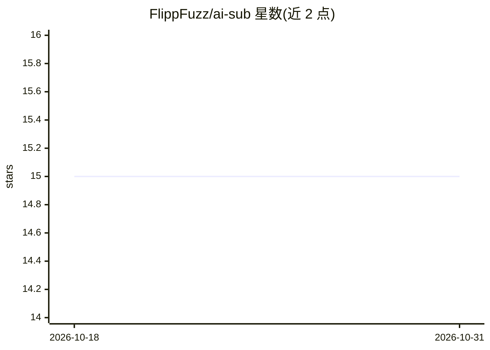

# FlippFuzz/ai-sub

⭐ 15 · Python · MIT · 推送 2026-10-30 · [GitHub](https://github.com/FlippFuzz/ai-sub) · 个人维护

**用 Gemini 生成视频双语字幕（原文+英译）的命令行工具**

命令行工具，调用 Google Gemini 模型对视频生成音频同步字幕：将视频切分为 5 分钟片段，可选压缩重编码后经 Gemini Files API 上传云端处理，以音频为时间基准、视觉为上下文生成字幕与英文翻译，最终拼合输出 SRT 文件。支持歌词网络搜索（Langsearch 或 DuckDuckGo）以提高歌曲转写准确率。需 Python 3.10+、Google AI Studio API key；已知限制包括时间戳偶有不准与模型幻觉。

## 筛选速览

| 维度 | 判定 | 备注 |
|---|---|---|
| AI 角色 | `ai-native` | 本体是模型或模型工具 |
| 许可风险 | `permissive` | MIT |
| 部署形态 | `library` | 以包/库形式分发 |
| 模型依赖 | — | README 未给出锁定关系 |
| 硬件要求 | — | 无带数字的原话,不猜 |
| 安装摩擦 | `low` | 无编译、无系统依赖或容器化 |
| 成熟度 | — | 结构信号不足 |

## 能力要点

- 生成原文+英文翻译的双语 SRT 字幕
- 视频分片、可选重编码（如 1fps/360p）降低带宽后经 Gemini Files API 云端处理
- 可选歌词网络搜索（Langsearch/DuckDuckGo）提升歌曲转写准确性
- 分段状态文件机制，可只重跑指定片段的指定阶段

## 适用场景

- 为外语视频生成带英文翻译的双语字幕
- 给含歌曲的视频做带歌词校正的字幕转写
- 利用 Gemini 免费配额批量处理视频字幕

## 场景标签

`语音识别` · 领域:感知与多模态

## 证据(README 行号)

> L10: **AI Sub** is a command-line tool that leverages Google's **Gemini** models to generate high-quality, audio-synchro
> L24: 5. **Generation:** Generates synchronized subtitles and translations by using the audio as the ground truth for tim

## 星数曲线

2026-10-18 15 → 2026-10-31 15（+0）

---
*卡片 v1 · prompt 1.4 · 生成 2026-10-30 · 置信度 high · 依据 README sha `ab6dd331b503` · [字段定义](../../DATASET.md)*
