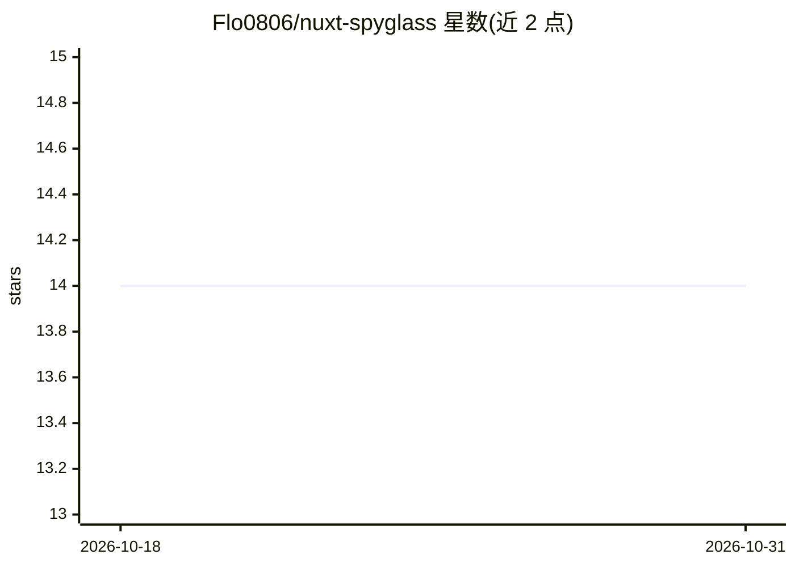

# Flo0806/nuxt-spyglass

⭐ 14 · TypeScript · MIT · 推送 2026-08-23 · [GitHub](https://github.com/Flo0806/nuxt-spyglass) · [官网](https://spyglass.fh-softdev.de) · 个人维护

**Nuxt 开发日志聚合模块：统一浏览器与服务端日志供 AI 经 MCP 读取**

面向 Nuxt 开发者的 dev-only 日志模块：捕获浏览器 console.*、未捕获错误与服务端 Nitro 抛错，统一写入单个 NDJSON 文件，并以 pageLoadId/requestId 将同一页面加载的浏览器与服务端条目关联。内置人类可用的终端日志查看器（live tail/搜索/着色），并随包附带 stdio MCP 服务器，向 AI agent 暴露 recent_errors、logs_for_page、search 等六个查询工具，附 Claude Code、Codex、GitHub Copilot 的注册示例。生产构建中自动禁用。

## 筛选速览

| 维度 | 判定 | 备注 |
|---|---|---|
| AI 角色 | `ai-enhanced` | 去掉 AI 部分产品仍成立 |
| 许可风险 | `permissive` | MIT |
| 部署形态 | `library` | 以包/库形式分发 |
| 模型依赖 | — | README 未给出锁定关系 |
| 硬件要求 | — | 无带数字的原话,不猜 |
| 安装摩擦 | `low` | 无编译、无系统依赖或容器化 |
| 成熟度 | — | 结构信号不足 |

## 能力要点

- 浏览器+服务端日志统一写入单个 NDJSON 文件
- pageLoadId/requestId 跨端关联同一页面加载的日志
- 内置 stdio MCP 服务器，提供 6 个日志查询工具
- 内置终端日志查看器（live tail/搜索），生产环境自动禁用

## 适用场景

- 调试时把浏览器与服务端错误放在同一处查看
- 让 AI 编程助手直接查询项目最近错误与关联日志
- 改代码后用增量日志查看效果

## 场景标签

 · 领域:Web 开发工具/日志

## 证据(README 行号)

> L14: `nuxt-spyglass` listens to **all** logs - Nitro (server) *and* browser, plain debug logs as well as thrown errors -
> L27: - 🤖 Built-in **stdio MCP server** so AI agents can query your logs
> L85: Spyglass ships `nuxt-spyglass-mcp`, a lightweight **stdio MCP server** that reads your log file and exposes it to A

## 星数曲线

2026-10-18 14 → 2026-10-31 14（+0）

---
*卡片 v1 · prompt 1.4 · 生成 2026-10-31 · 置信度 high · 依据 README sha `ce036aa6f2e2` · [字段定义](../../DATASET.md)*
