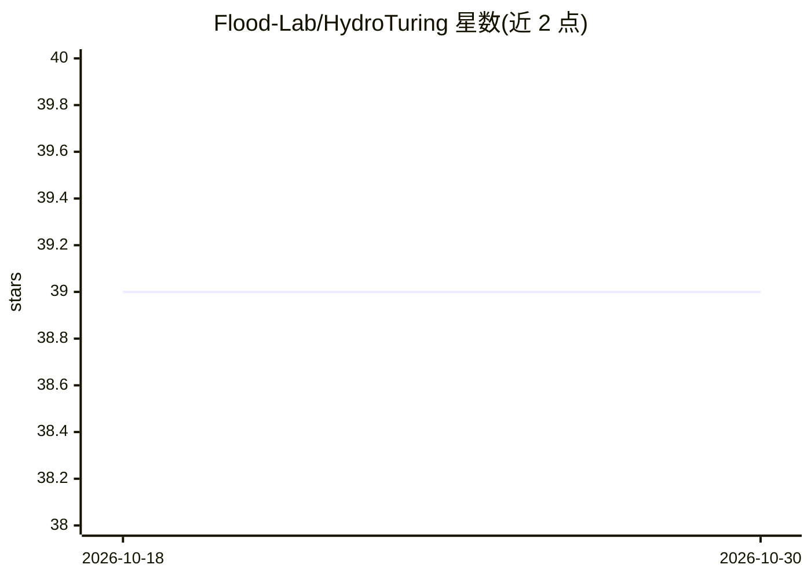

# Flood-Lab/HydroTuring

⭐ 39 · Python · NOASSERTION · 推送 2026-10-28 · [GitHub](https://github.com/Flood-Lab/HydroTuring) · [官网](https://flood-lab.github.io/HydroTuring/) · 组织维护

**AI 水文模型的物理守恒基准测试套件**

面向 AI 水文模型的基准测试：通过 37 个探针（质量守恒 24、能量守恒 7、动量守恒 6）检验模型的水量、能量收支是否闭合及动量是否守恒，全部探针通过才算通过。模型经 /io 接口接入，用 ht 命令行运行探针并输出判定结果。仓库内置故意损坏的对照模型（如 reference_cheater）防止基准被规避，含 4 个物理模型（精确桶模型、两个 FLEX、SAC-SMA with Snow-17）用于验证探针本身。社区可提交探针或模型，合并一个探针可获论文共同署名。

## 筛选速览

| 维度 | 判定 | 备注 |
|---|---|---|
| AI 角色 | `ai-ecosystem` | LLM/agent 周边工具 |
| 许可风险 | `none` | NOASSERTION |
| 部署形态 | `self-host` | docker 或自建部署 |
| 模型依赖 | — | README 未给出锁定关系 |
| 硬件要求 | — | 无带数字的原话,不猜 |
| 安装摩擦 | `low` | 无编译、无系统依赖或容器化 |
| 成熟度 | — | 结构信号不足 |

## 能力要点

- 37 个探针覆盖质量、能量、动量三类守恒律
- 内置故意损坏的对照模型防止基准被规避
- 探针合并前须通过精确参考模型并捕捉其命名的损坏模型
- 社区提交探针或模型可获论文共同署名

## 适用场景

- 检验我训练的 AI 水文模型是否守恒水量与能量
- 以物理守恒标准对比评估多个水文模型
- 贡献新的守恒探针并参与论文署名

## 场景标签

`模型评测` · 领域:评测与运维

## 证据(README 行号)

> L12: A benchmark that asks one question of any AI hydrologic model: **does it
> L41:  Any AI hydrologic model enters through the /io contract, HydroTuring probes it against mass, energy and momentum, 
> L59: Thirty-seven: twenty-four under mass, seven under energy and six under momentum.

## 星数曲线

2026-10-18 39 → 2026-10-30 39（+0）

---
*卡片 v1 · prompt 1.4 · 生成 2026-10-25 · 置信度 high · 依据 README sha `0e70faa1f781` · [字段定义](../../DATASET.md)*
