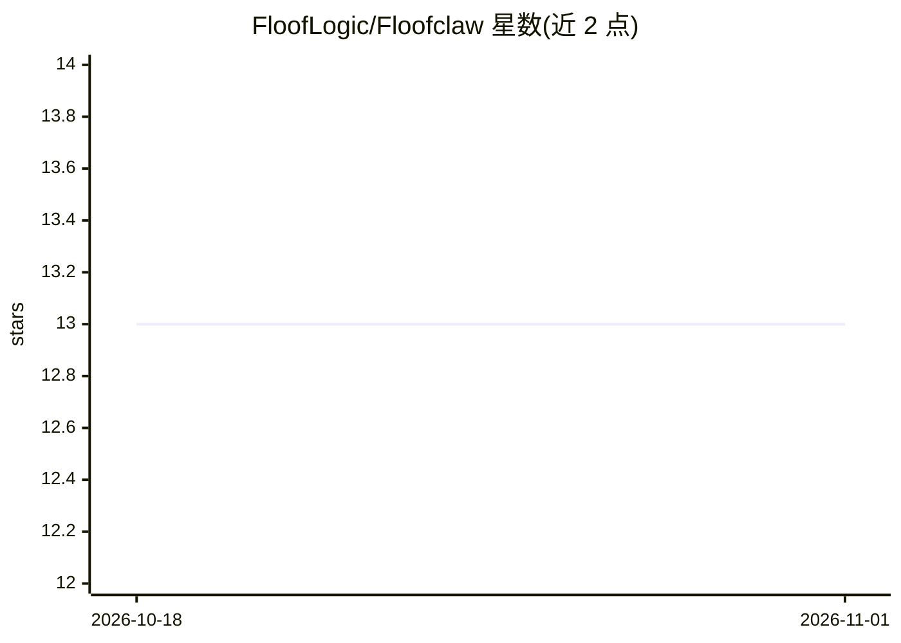

# FloofLogic/Floofclaw

⭐ 13 · C · Apache-2.0 · 推送 2026-09-28 · [GitHub](https://github.com/FloofLogic/Floofclaw) · [官网](https://floofclaw.com/) · 组织维护

**C11 编写的持久化 AI agent 运行时，事件驱动、可重启恢复**

纯 C 实现的本地 agent 运行时引擎：将消息、定时器、API 调用与 worker 结果组织为可检视的事件驱动 run，事件日志追加写、状态文件可重建，崩溃后可重放。以文件系统为持久层，不依赖数据库。所有 CLI 命令默认输出 JSON/JSONL，供 agent 与脚本组合使用；模型调用的请求、响应、token 与缓存均可审计。支持 macOS/Linux/Android ARM64 源码构建，v0.30.0 起提供 macOS arm64 原生归档。真实 HTTP 提供商需可选 libcurl，TLS 通道需 OpenSSL 3。

## 筛选速览

| 维度 | 判定 | 备注 |
|---|---|---|
| AI 角色 | `ai-ecosystem` | LLM/agent 周边工具 |
| 许可风险 | `permissive` | Apache-2.0 |
| 部署形态 | `None` |  |
| 模型依赖 | — | README 未给出锁定关系 |
| 硬件要求 | — | 无带数字的原话,不猜 |
| 安装摩擦 | `medium` | 含编译或系统依赖之一 |
| 成熟度 | — | 结构信号不足 |

## 能力要点

- 纯 C 内核，release-small 构建约 560 KiB，无 Node/Python/JVM 运行时
- 文件系统即数据库：追加式事件日志为事实源，run 崩溃后可重放
- 从 MCP 服务器目录生成普通 action（fclaw mcp sync），不内嵌 MCP 客户端
- Discord/Telegram/IRC/WS 四种原生适配器

## 适用场景

- 运行需要跨重启持续工作的长期 agent 任务
- 审计每次模型调用的请求、成本与缓存边界
- 在 Discord/Telegram 频道上接收文本与多媒体文件驱动 agent
- 以脚本/agent 方式组合操作运行时的全部命令

## 场景标签

`Agent 框架` · 领域:Agent 开发

## 证据(README 行号)

> L13: **FloofClaw is a tiny C runtime for durable AI agents.** It turns messages,
> L78: > FloofClaw is not another chatbot framework. It is the engine agents run

## 星数曲线

2026-10-18 13 → 2026-11-01 13（+0）

---
*卡片 v1 · prompt 1.4 · 生成 2026-10-31 · 置信度 high · 依据 README sha `b2e8bc91e95a` · [字段定义](../../DATASET.md)*
