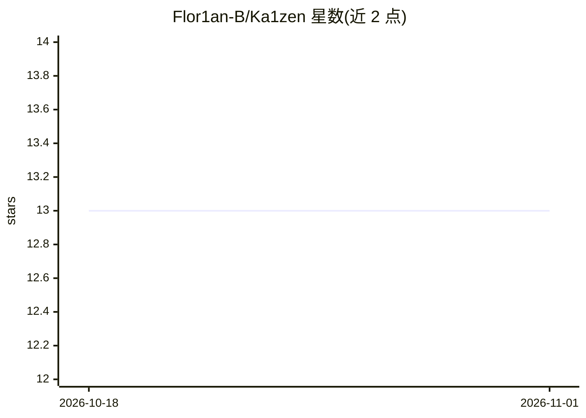

# Flor1an-B/Ka1zen

⭐ 13 · NOASSERTION · 推送 2026-10-30 · [GitHub](https://github.com/Flor1an-B/Ka1zen) · [官网](https://github.com/Flor1an-B/Ka1zen/releases/latest) · 个人维护

**macOS 本地 LLM 聊天应用：Apple Silicon 离线运行开源模型**

原生 macOS 应用，通过 Apple MLX 框架在本地运行开源大语言模型（Qwen、Gemma、DeepSeek、Mistral、Llama 等），辅以 llama.cpp 运行 GGUF 模型。面向注重隐私、零成本与学习的 Mac 用户。功能含本地对话、视觉、思考模式、网页搜索、mflux 本地图像生成/编辑、RAG（本地嵌入+SQLite）、语音输入与 TTS、token 概率检查、OpenAI 兼容 API Relay。要求 macOS 15+、Apple Silicon、16GB 内存、python.org 版 Python 3.14。以 .dmg 分发，源码未公开，PolyForm Noncommercial 许可，商用需另行书面授权。

## 筛选速览

| 维度 | 判定 | 备注 |
|---|---|---|
| AI 角色 | `ai-native` | 本体是模型或模型工具 |
| 许可风险 | `none` | NOASSERTION |
| 部署形态 | `desktop` | 安装包/桌面程序 |
| 模型依赖 | local-ok | 支持本地模型 |
| 硬件要求 | — | 无带数字的原话,不猜 |
| 安装摩擦 | `low` | 无编译、无系统依赖或容器化 |
| 成熟度 | — | 结构信号不足 |

## 能力要点

- MLX 主引擎 + llama.cpp GGUF 备用引擎双引擎架构
- FLUX.2/Qwen-Image 等本地图像生成与编辑（mflux）
- 本地 RAG（Apple NLEmbedding + SQLite）与 token logprobs 检查
- OpenAI 兼容 API Relay 供 Continue/Cursor/Zed 接入

## 适用场景

- 在 Mac 上离线运行开源 LLM 对话，数据不出本机
- 本地处理 PDF/代码做 RAG 问答
- 为 Continue/Cursor 等编辑器提供本地 OpenAI 兼容接口
- 本地生成与编辑图像

## 场景标签

`聊天机器人` `图像生成` `语音合成` `文档问答` · 领域:对话与助手

## 证据(README 行号)

> L6:  Chat with open LLMs entirely offline on your Mac — private by design, powered by Apple MLX.
> L26: Ka1zen is a native macOS app that runs open large-language models **locally** on your Mac via Apple's **MLX** frame
> L37: |💬 **Local chat**|Qwen, Gemma, DeepSeek, Mistral, Llama — anything on mlx-community|

## 星数曲线

2026-10-18 13 → 2026-11-01 13（+0）

---
*卡片 v1 · prompt 1.4 · 生成 2026-10-31 · 置信度 mid · 依据 README sha `9eda9b209dff` · [字段定义](../../DATASET.md)*
