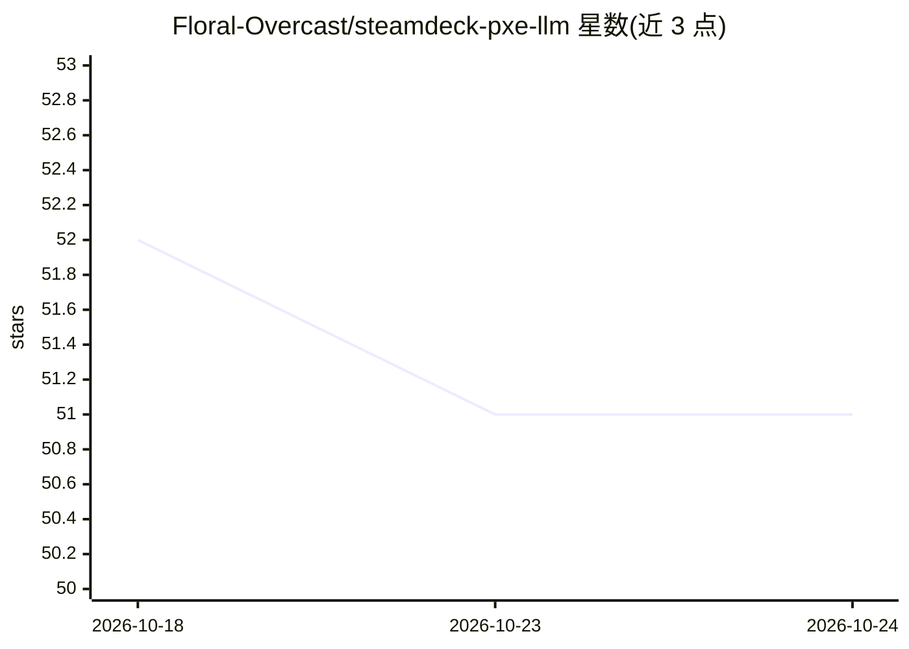

# Floral-Overcast/steamdeck-pxe-llm

⭐ 51 · Shell · MIT · 推送 2026-09-26 · [GitHub](https://github.com/Floral-Overcast/steamdeck-pxe-llm) · 个人维护

**将 Steam Deck 主板改为无盘 PXE 启动的本地 LLM 推理节点集群**

面向 homelab 爱好者的方案仓库：把拆机 Steam Deck 主板（OLED/LCD）做成无盘、PXE 网络启动的 LLM 节点，约两分钟即在 8080 端口提供 OpenAI 兼容 API 并在 GPU 上运行 8B 模型，板上不写入任何数据。提供 PXE 启动链（PXE→iPXE→内存中的 Fedora CoreOS）、通过 amdgpu overdrive 钉住 GPU 频率以解除无电池时的降频限制（8B Q4 模型约 12.4 tok/s），以及 dnsmasq/HTTP/NFS 的宿主机配置脚本与完整文档。MIT 许可。

## 筛选速览

| 维度 | 判定 | 备注 |
|---|---|---|
| AI 角色 | `ai-ecosystem` | LLM/agent 周边工具 |
| 许可风险 | `permissive` | MIT |
| 部署形态 | `None` |  |
| 模型依赖 | — | README 未给出锁定关系 |
| 硬件要求 | — | 无带数字的原话,不猜 |
| 安装摩擦 | `low` | 无编译、无系统依赖或容器化 |
| 成熟度 | — | 结构信号不足 |

## 能力要点

- 无盘 PXE 启动：Fedora CoreOS 在内存中运行，板上不留痕迹
- amdgpu overdrive 钉 GPU 频率，将推理速度从 <2 tok/s 恢复到约 12.4 tok/s（8B Q4）
- 提供 setup-host.sh 一键宿主机脚本与可复制的完整 runbook 文档
- 节点身份由 DHCP 分配，换模型只需改一行配置加重启服务

## 适用场景

- 用廉价拆机 Steam Deck 主板搭建分布式本地 LLM 集群
- 以 OpenAI 兼容 API 形式在局域网内提供本地模型推理
- 学习无盘 PXE 启动与 AMD GPU 频率控制实践

## 场景标签

`推理引擎` · 领域:训练与推理

## 证据(README 行号)

> L5: OpenAI-compatible API on port 8080, running an 8B model on its GPU. Nothing is written
> L41: - **A PXE host**: any always-on Linux box (a mini PC, an old laptop, a Raspberry Pi, a

## 星数曲线

2026-10-18 52 → 2026-10-24 51（-1）

---
*卡片 v1 · prompt 1.4 · 生成 2026-10-24 · 置信度 high · 依据 README sha `7e9695a58cb7` · [字段定义](../../DATASET.md)*
