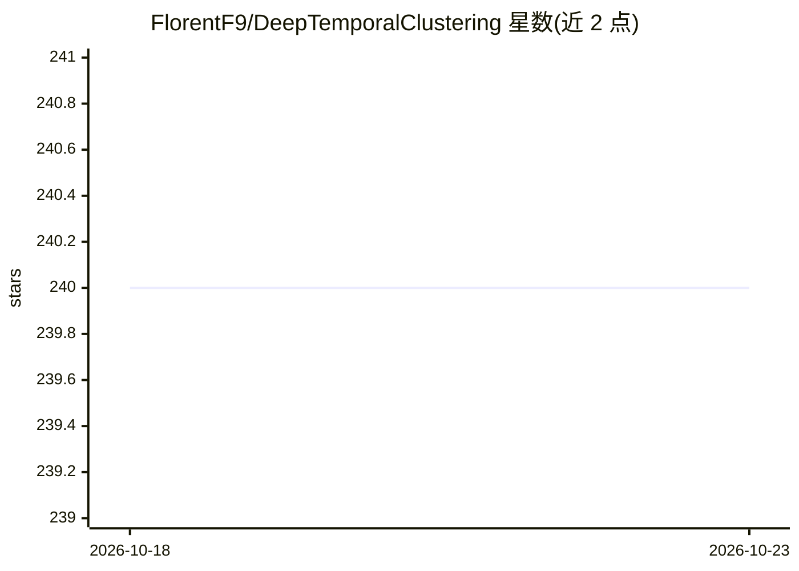

# FlorentF9/DeepTemporalClustering

⭐ 240 · Python · MIT · 推送 2025-12-05 · [GitHub](https://github.com/FlorentF9/DeepTemporalClustering) · 个人维护

**DTC 时间序列深度聚类模型的 Keras 复现实现**

Keras 实现的 Deep Temporal Clustering (DTC) 模型，对多元时间序列进行联合表示学习与聚类，复现论文全部功能：热力图生成网络可视化聚类归因区域、层次聚类或 k-means 初始化、3 种已实现的时间序列距离度量（EUCL/CID/COR，ACF 未实现）。面向科研与算法开发者，通过命令行参数调超参，附带 Streamlit 界面与 UCR/UEA 数据集加载。原作者未公开代码，作者声明不保证与原实现完全一致。

## 筛选速览

| 维度 | 判定 | 备注 |
|---|---|---|
| AI 角色 | `ai-native` | 本体是模型或模型工具 |
| 许可风险 | `permissive` | MIT |
| 部署形态 | `library` | 以包/库形式分发 |
| 模型依赖 | — | README 未给出锁定关系 |
| 硬件要求 | — | 无带数字的原话,不猜 |
| 安装摩擦 | `low` | 无编译、无系统依赖或容器化 |
| 成熟度 | — | 结构信号不足 |

## 能力要点

- 多元时间序列联合表示学习与聚类
- 热力图生成网络定位影响聚类的时间序列区域
- 层次聚类/k-means 初始化与 EUCL/CID/COR 三种距离度量
- 附带 UCR/UEA 数据集加载与 purity/聚类准确率/ROC-AUC 评估指标

## 适用场景

- 对多元时间序列做无监督聚类实验
- 复现或扩展 DTC 论文中的模型
- 通过 Streamlit 界面在浏览器中调整数据集与训练参数

## 场景标签

`科研工具` · 领域:学习与行业

## 证据(README 行号)

> L3: This is a Keras implementation of the **Deep Temporal Clustering (DTC)** model, an architecture for joint representa
> L5: > Madiraju, N. S., Sadat, S. M., Fisher, D., & Karimabadi, H. (2018). Deep Temporal Clustering : Fully Unsupervised 

## 星数曲线

2026-10-18 240 → 2026-10-23 240（+0）

---
*卡片 v1 · prompt 1.4 · 生成 2026-10-22 · 置信度 mid · 依据 README sha `af8c0914a060` · [字段定义](../../DATASET.md)*
