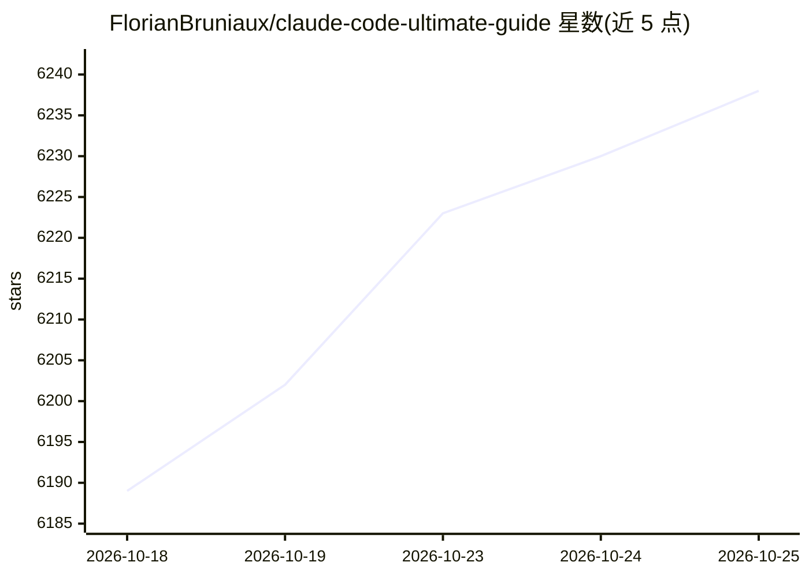

# FlorianBruniaux/claude-code-ultimate-guide

⭐ 6,238 · Python · CC-BY-SA-4.0 · 推送 2026-10-24 · [GitHub](https://github.com/FlorianBruniaux/claude-code-ultimate-guide) · [官网](https://cc.bruniaux.com/) · 个人维护

**Claude Code 工程实践指南：教开发者构建与规模化 agent 使用**

面向使用 Claude Code 的开发者与技术管理者的知识库：以 430K+ 行 Markdown 源文件提供 agentic 工作流、hooks、skills、MCP 服务器、安全加固、团队治理、评测与成本经济等章节，并含测验、速查卡与 PDF/EPUB 电子书。仓库同时提供机器可读索引（llms.txt、reference.yaml）和一个经 npx 安装的 MCP 服务器（17 个工具），可从 Claude Code、Codex、Cursor、VS Code 等 MCP 客户端查询指南内容。指南以 CC BY-SA 4.0 许可发布，网站为主要阅读界面。

## 筛选速览

| 维度 | 判定 | 备注 |
|---|---|---|
| AI 角色 | `ai-knowledge` | 知识聚合/清单类 |
| 许可风险 | `viral` | CC-BY-SA-4.0 |
| 部署形态 | `library` | 以包/库形式分发 |
| 模型依赖 | — | README 未给出锁定关系 |
| 硬件要求 | — | 无带数字的原话,不猜 |
| 安装摩擦 | `low` | 无编译、无系统依赖或容器化 |
| 成熟度 | — | 结构信号不足 |

## 能力要点

- 覆盖 Start/Build/Scale 三阶段的 Claude Code 学习路径与工作流
- 官方 MCP 服务器提供 17 个工具（搜索指南、对比版本、威胁查询等）
- 提供 Markdown、速查卡、测验、PDF/EPUB 多种格式及法英双语卡片
- 含机器可读索引（llms.txt、navigation.json、reference.yaml）

## 适用场景

- 系统学习 Claude Code 从入门到生产化使用
- 为团队制定 AI 编码工具的安全边界与治理策略
- 通过 MCP 服务器在任意编码客户端内查询指南内容

## 场景标签

`教程课程` · 领域:学习与行业

## 证据(README 行号)

> L15: Learn Claude Code, build reliable agents, and scale their use safely. The website is the primary reading and discov
> L33: Claude Code documentation explains the product. This guide connects product behavior to engineering decisions: what

## 星数曲线

2026-10-18 6,189 → 2026-10-25 6,238（+49）

---
*卡片 v1 · prompt 1.4 · 生成 2026-10-20 · 置信度 high · 依据 README sha `344db28ed567` · [字段定义](../../DATASET.md)*
