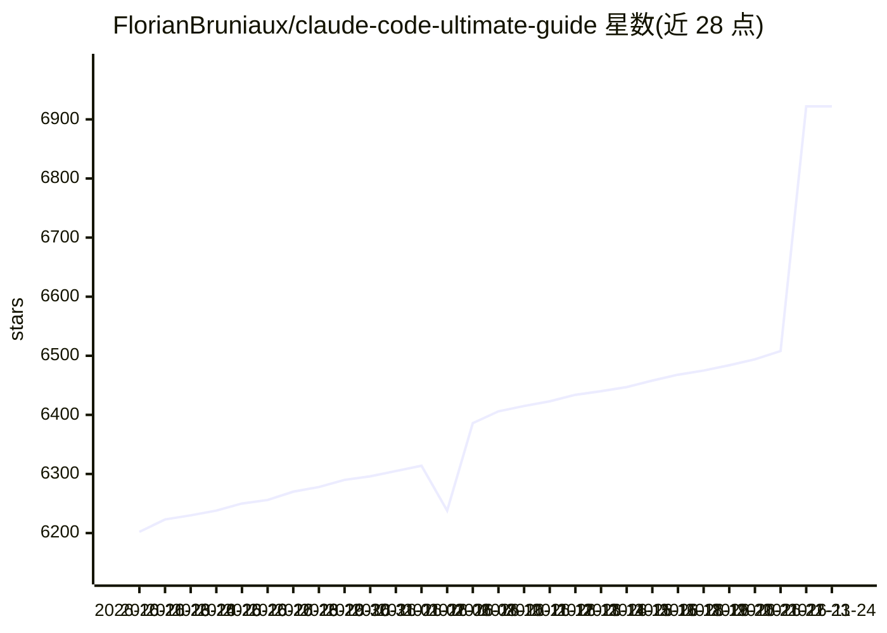

# FlorianBruniaux/claude-code-ultimate-guide

⭐ 6,922 · Python · CC-BY-SA-4.0 · 推送 2026-11-22 · [GitHub](https://github.com/FlorianBruniaux/claude-code-ultimate-guide) · [官网](https://cc.bruniaux.com/) · 个人维护

**Claude Code 工程实践指南：教程、模板与 MCP 服务器**

以 Markdown 源文件形式收录的 Claude Code 使用与工程指南，配套网站作为主阅读界面。内容按 Start/Build/Scale 组织，覆盖智能体工程、上下文与记忆、工作流、安全加固、可观测性、团队采纳与成本核算等章节，并按角色给出多条学习路径。仓库提供可运行的 agents/skills/hooks 示例文件、测验、速查表、EPUB/PDF 电子书，以及通过 npx 分发的 stdio MCP 服务器（17 个工具、7 个资源），可在 Claude Code、Codex、Cursor、VS Code 等 MCP 客户端中查询指南内容。指南采用 CC BY-SA 4.0 许可。

## 筛选速览

| 维度 | 判定 | 备注 |
|---|---|---|
| AI 角色 | `ai-knowledge` | 知识聚合/清单类 |
| 许可风险 | `viral` | CC-BY-SA-4.0 |
| 部署形态 | `library` | 以包/库形式分发 |
| 模型依赖 | — | README 未给出锁定关系 |
| 硬件要求 | — | 无带数字的原话,不猜 |
| 安装摩擦 | `low` | 无编译、无系统依赖或容器化 |
| 成熟度 | — | 结构信号不足 |

## 能力要点

- MCP 服务器形式分发指南（17 个工具、7 个资源、1 个 prompt）
- 覆盖智能体工程、上下文工程、安全加固、企业治理与 AI FinOps 章节
- 按角色（开发者/管理者/安全/PM）提供多条学习路径
- 附可运行示例文件与 CLAUDE.md 模板

## 适用场景

- 系统学习 Claude Code 的智能体工作流与 hooks/skills/MCP 用法
- 为团队制定 Claude Code 安全边界与治理规范
- 在 IDE 编码客户端中通过 MCP 查询指南内容

## 场景标签

`教程课程` · 领域:学习与行业

## 证据(README 行号)

> L16: Learn Claude Code, build reliable agents, and scale their use safely. The website is the primary reading and discov
> L34: Claude Code documentation explains the product. This guide connects product behavior to engineering decisions: what
> L237: ## MCP Server: Use the guide from any coding client

## 星数曲线

2026-10-21 6,202 → 2026-11-24 6,922（+720）

---
*卡片 v1 · prompt 1.4 · 生成 2026-11-23 · 置信度 high · 依据 README sha `1ba678077eec` · [字段定义](../../DATASET.md)*
