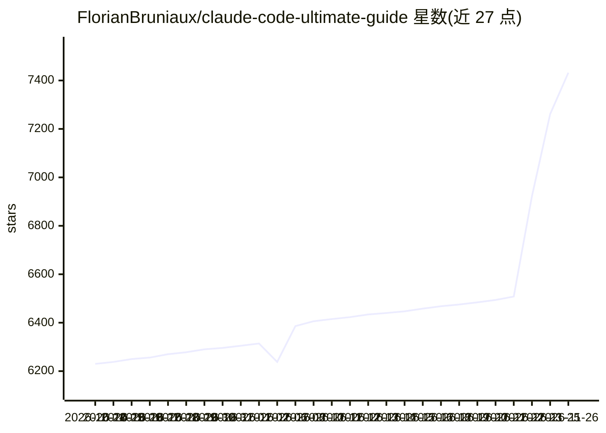

# FlorianBruniaux/claude-code-ultimate-guide

⭐ 7,432 · Python · CC-BY-SA-4.0 · 推送 2026-11-25 · [GitHub](https://github.com/FlorianBruniaux/claude-code-ultimate-guide) · [官网](https://cc.bruniaux.com/) · 个人维护

**面向开发者的 Claude Code 使用与工程化教学指南**

以网站为主阅读界面、仓库承载规范 Markdown 源文件的 Claude Code 指南，版本 3.46.0，采用 CC BY-SA 4.0 许可。内容覆盖 agent harness 设计、上下文工程、记忆系统、工作流、安全加固、企业治理、可观测性与 AI 成本核算，并提供学习路径、测验、速查表、示例工程与机器可读索引。附带一个通过 npx 分发的 MCP 服务器（17 个工具、7 个资源），可从 Claude Code、Codex、Cursor 等 MCP 客户端查询指南内容。

## 筛选速览

| 维度 | 判定 | 备注 |
|---|---|---|
| AI 角色 | `ai-knowledge` | 知识聚合/清单类 |
| 许可风险 | `viral` | CC-BY-SA-4.0 |
| 部署形态 | `library` | 以包/库形式分发 |
| 模型依赖 | — | README 未给出锁定关系 |
| 硬件要求 | — | 无带数字的原话,不猜 |
| 安装摩擦 | `low` | 无编译、无系统依赖或容器化 |
| 成熟度 | — | 结构信号不足 |

## 能力要点

- 覆盖从入门学习到企业规模化落地的多角色学习路径
- 提供 npx 分发的 MCP 服务器，含 17 个工具与 7 个资源，可接入多种编码客户端
- 指南源文件为 Markdown，附带机器可读索引（navigation.json、llms.txt、reference.yaml）
- 包含可运行的示例工程（agents、skills、hooks、workflows、脚本）

## 适用场景

- 为团队新成员按角色选择 Claude Code 学习路径
- 查阅 agent harness、上下文工程与安全加固的工程化做法
- 将指南以 MCP 服务器形式接入本地编码客户端随时检索

## 场景标签

`教程课程` · 领域:学习与行业

## 证据(README 行号)

> L17: Learn Claude Code, build reliable agents, and scale their use safely. The website is the primary reading and discov
> L258: |Tools|17|`compare_versions`, `diff_official_docs`, `get_changelog`, `get_cheatsheet`, `get_digest`, `get_example`

## 星数曲线

2026-10-24 6,230 → 2026-11-26 7,432（+1,202）

---
*卡片 v1 · prompt 1.4 · 生成 2026-11-26 · 置信度 high · 依据 README sha `77630b027a9f` · [字段定义](../../DATASET.md)*
