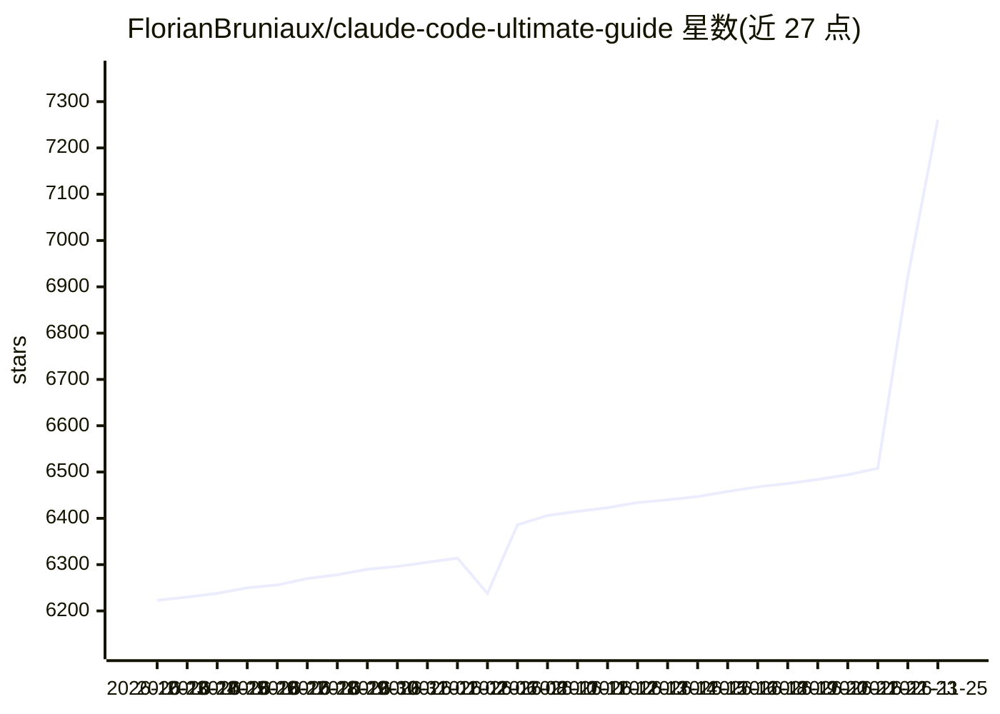

# FlorianBruniaux/claude-code-ultimate-guide

⭐ 7,261 · Python · CC-BY-SA-4.0 · 推送 2026-11-23 · [GitHub](https://github.com/FlorianBruniaux/claude-code-ultimate-guide) · [官网](https://cc.bruniaux.com/) · 个人维护

**面向开发者的 Claude Code 使用与工程实践指南**

以网站为主阅读界面、本仓库为 Markdown 规范源的内容型指南，覆盖 Claude Code 的架构、Agent 工程、上下文与记忆、工作流、安全加固、企业治理、可观测性与成本核算等主题。提供学习路径、测验、速查表、可运行示例与模板；通过 npx 提供 stdio MCP 服务器（17 个工具、7 个资源），可从 Claude Code、Codex、Cursor、VS Code 等 MCP 客户端查询指南内容。内容以 CC BY-SA 4.0 许可发布，由一位官方 Claude Community Ambassador 维护。

## 筛选速览

| 维度 | 判定 | 备注 |
|---|---|---|
| AI 角色 | `ai-knowledge` | 知识聚合/清单类 |
| 许可风险 | `viral` | CC-BY-SA-4.0 |
| 部署形态 | `library` | 以包/库形式分发 |
| 模型依赖 | locked-api |  |
| 硬件要求 | — | 无带数字的原话,不猜 |
| 安装摩擦 | `low` | 无编译、无系统依赖或容器化 |
| 成熟度 | — | 结构信号不足 |

## 能力要点

- 按 Start/Build/Scale/Resources 组织的多角色学习路径
- 提供可运行的 agents、skills、hooks、workflow 示例文件
- 指南本身可通过 npx 作为 stdio MCP 服务器接入各类编码客户端
- 提供 llms.txt 与 reference.yaml 机器可读索引

## 适用场景

- 系统学习 Claude Code 的安装、配置与日常使用
- 为团队制定 AI 辅助开发的安全边界与治理流程
- 把指南作为 MCP 服务器接入编码客户端随时检索

## 场景标签

`教程课程` · 领域:学习与行业

## 证据(README 行号)

> L17: Learn Claude Code, build reliable agents, and scale their use safely. The website is the primary reading and discov

## 星数曲线

2026-10-23 6,223 → 2026-11-25 7,261（+1,038）

---
*卡片 v1 · prompt 1.4 · 生成 2026-11-24 · 置信度 high · 依据 README sha `d4f64a44bdde` · [字段定义](../../DATASET.md)*
