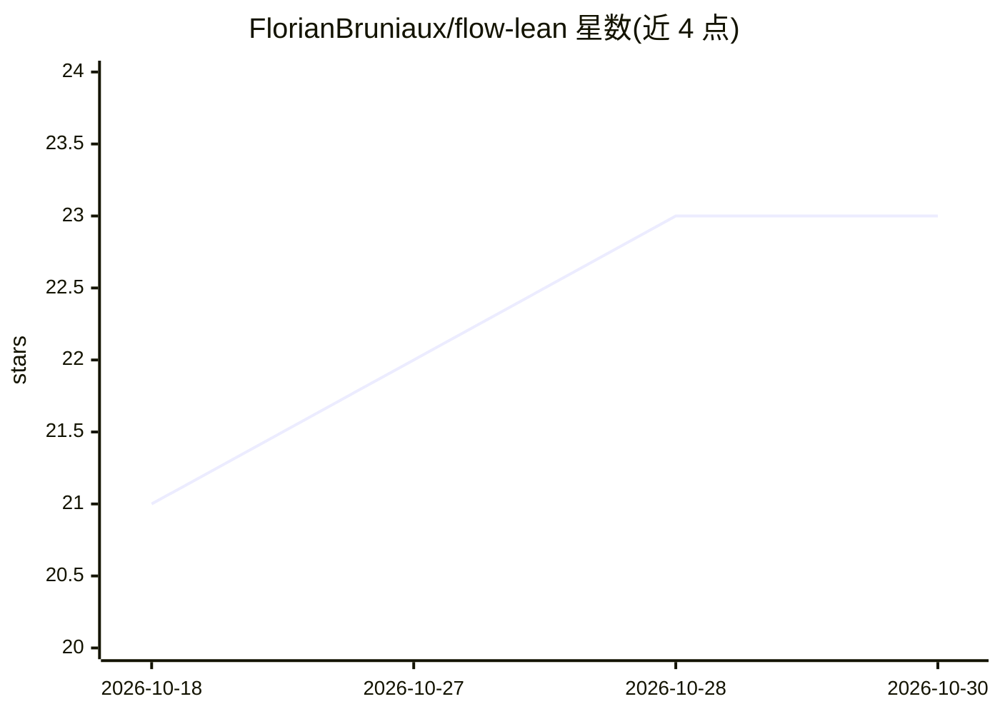

# FlorianBruniaux/flow-lean

⭐ 23 · Python · MIT · 推送 2026-10-25 · [GitHub](https://github.com/FlorianBruniaux/flow-lean) · 个人维护

**模型无关的 LLM agent 输出风格控制技能：简洁、行动优先、保留证据与风险**

以纯 Markdown SKILL.md 形式分发的 agent 技能，融合三个已有技能（caveman/ponytail/i-have-adhd）的规则，按“每个 token 都须有其位置”的单一规则约束回答：结论先行、默认约 80 词、用 /flow-lean detailed|concise|ultra 切换密度、保留证据/风险/授权边界。原生支持 Claude Code 与 Codex 插件安装，其他宿主可通过各自技能机制加载；README 明确压缩率数据为历史快照而非当前声明。

## 筛选速览

| 维度 | 判定 | 备注 |
|---|---|---|
| AI 角色 | `ai-ecosystem` | LLM/agent 周边工具 |
| 许可风险 | `permissive` | MIT |
| 部署形态 | `library` | 以包/库形式分发 |
| 模型依赖 | locked-api |  |
| 硬件要求 | — | 无带数字的原话,不猜 |
| 安装摩擦 | `low` | 无编译、无系统依赖或容器化 |
| 成熟度 | — | 结构信号不足 |

## 能力要点

- 三档密度切换（detailed/concise/ultra）+ lite/full 别名
- 结论先行、稳定句柄（D1/R1）、可选 Skills used 页脚
- Claude Code 与 Codex 原生插件安装路径，其他宿主加载同一 SKILL.md
- 附带 25/30 用例回归评测集与真实 API 盲评 harness

## 适用场景

- 让编程 agent 回答更简短、行动优先
- 统一团队内 agent 的输出密度与风险披露规范
- 在不同宿主（Claude Code/Codex/其他）间复用同一输出控制规则

## 场景标签

`提示工程` · 领域:Agent 开发

## 证据(README 行号)

> L8: Adaptive output control for LLM agents: minimal solution, action-first
> L102: Use the canonical `skills/flow-lean/SKILL.md`
> L104: developer, or project instructions. The rules are model-agnostic Markdown;

## 星数曲线

2026-10-18 21 → 2026-10-30 23（+2）

---
*卡片 v1 · prompt 1.4 · 生成 2026-10-27 · 置信度 mid · 依据 README sha `d973fb8dac95` · [字段定义](../../DATASET.md)*
