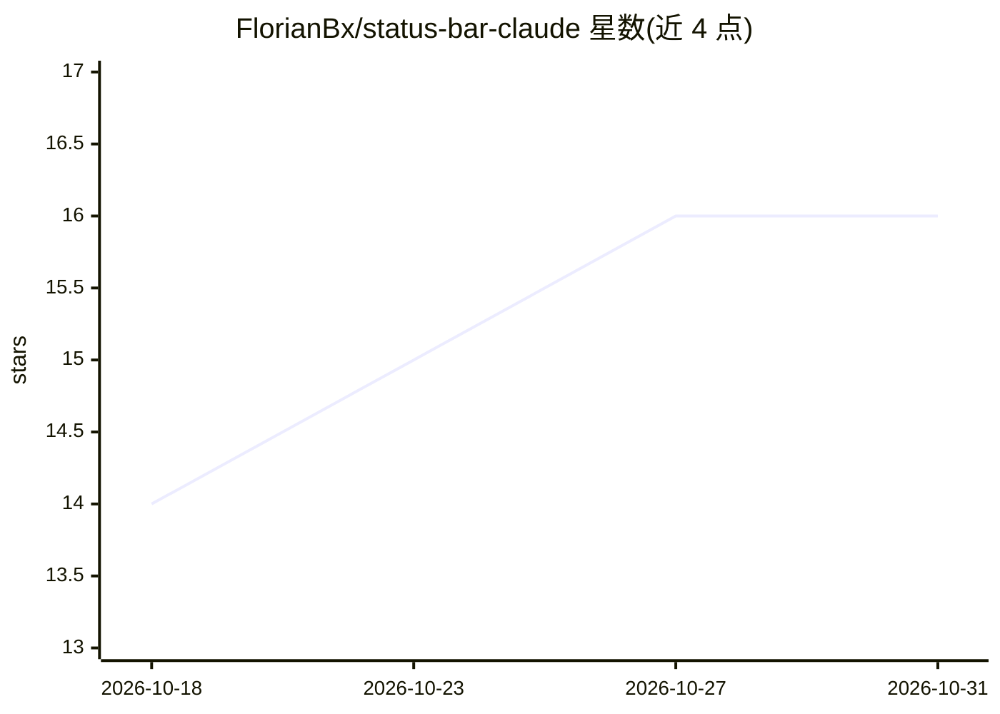

# FlorianBx/status-bar-claude

⭐ 16 · Shell · MIT · 推送 2026-04-26 · [GitHub](https://github.com/FlorianBx/status-bar-claude) · 个人维护

**在终端状态栏显示 Claude Code 上下文与限额的 shell 脚本**

单文件 bash 脚本，作为 Claude Code 的 statusLine 命令运行：从 stdin 读取 Claude Code 传入的 JSON，向 stdout 输出彩色状态串，显示当前目录、git 分支、模型名、上下文窗口使用率、5 小时与 7 天速率限额进度条及重置时间。颜色按阈值变化（50%/75%/90%）。一行安装脚本会复制文件并修改 ~/.claude/settings.json。依赖 bash、jq、git，面向使用 Claude Code 的开发者。

## 筛选速览

| 维度 | 判定 | 备注 |
|---|---|---|
| AI 角色 | `ai-ecosystem` | LLM/agent 周边工具 |
| 许可风险 | `permissive` | MIT |
| 部署形态 | `None` |  |
| 模型依赖 | — | README 未给出锁定关系 |
| 硬件要求 | — | 无带数字的原话,不猜 |
| 安装摩擦 | `low` | 无编译、无系统依赖或容器化 |
| 成熟度 | — | 结构信号不足 |

## 能力要点

- 以 statusLine 命令形式读取 stdin JSON 并输出彩色状态串
- 显示上下文窗口用量、5h/7d 限额进度条与 5 小时重置时间
- install.sh 一行安装并自动修改 settings.json

## 适用场景

- 在终端中实时查看 Claude Code 的上下文与限额消耗
- 接近速率限额时通过颜色变化获得提示
- 集成到 Claude Code statusLine 配置中

## 场景标签

`LLM 可观测性` · 领域:评测与运维

## 证据(README 行号)

> L3: A shell script that renders a real-time Claude Code status line in your terminal.
> L56: The script reads JSON from stdin (provided by Claude Code) and prints a colored status string to stdout.
> L32: This copies `statusline-command.sh` to `~/.claude/` and patches `~/.claude/settings.json` with the required `status

## 星数曲线

2026-10-18 14 → 2026-10-31 16（+2）

---
*卡片 v1 · prompt 1.4 · 生成 2026-10-30 · 置信度 high · 依据 README sha `eec20437a371` · [字段定义](../../DATASET.md)*
