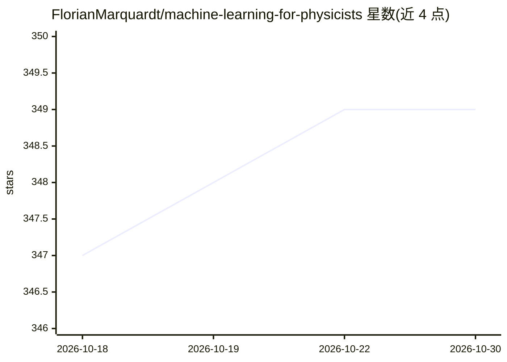

# FlorianMarquardt/machine-learning-for-physicists

⭐ 349 · Jupyter Notebook · 推送 2026-05-14 · [GitHub](https://github.com/FlorianMarquardt/machine-learning-for-physicists) · [官网](https://machine-learning-for-physicists.org/) · 组织维护

**物理学家机器学习课程的教学代码集合**

Florian Marquardt 主讲课程《Machine Learning for Physicists》的配套代码仓库，供课程学习者使用。README 仅说明代码与课程官网（含讲义、视频、内容摘要）关联，详细代码说明见官网，未在仓库内列出安装或运行方式。除少数明确标注来自他人的代码（如 tSNE 和 MNIST 相关）外，其余代码以 MIT 许可提供，此前为 CC BY-SA 4.0，使用者可任选其一。

## 筛选速览

| 维度 | 判定 | 备注 |
|---|---|---|
| AI 角色 | `ai-knowledge` | 知识聚合/清单类 |
| 许可风险 | `none` | — |
| 部署形态 | `None` |  |
| 模型依赖 | — | README 未给出锁定关系 |
| 硬件要求 | — | 无带数字的原话,不猜 |
| 安装摩擦 | `low` | 无编译、无系统依赖或容器化 |
| 成熟度 | — | 结构信号不足 |

## 能力要点

- 课程系列配套代码，与官网讲义/视频关联
- 主体代码以 MIT 许可提供（可选 CC BY-SA 4.0）
- 第三方代码（tSNE、MNIST 等）明确标注

## 适用场景

- 跟随课程学习并运行示例代码
- 查找物理向机器学习教学实现

## 场景标签

`教程课程` · 领域:学习与行业

## 证据(README 行号)

> L1: # Code for "Machine Learning for Physicists" (lecture series by Florian Marquardt)
> L3: Please see the official course website which has links to the current course where you eventually find links to slid

## 星数曲线

2026-10-18 347 → 2026-10-30 349（+2）

---
*卡片 v1 · prompt 1.4 · 生成 2026-10-22 · 置信度 mid · 依据 README sha `38b62b1d6efe` · [字段定义](../../DATASET.md)*
