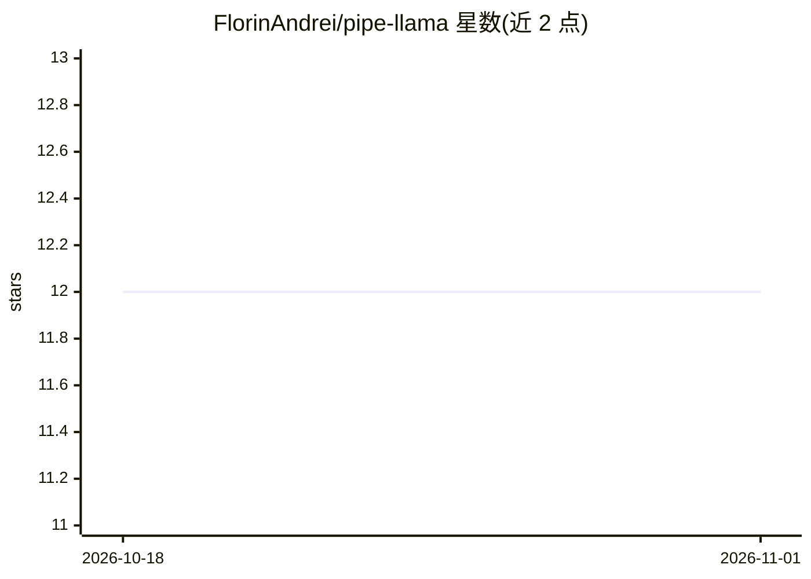

# FlorinAndrei/pipe-llama

⭐ 12 · Go · 推送 2026-01-23 · [GitHub](https://github.com/FlorinAndrei/pipe-llama) · 个人维护

**把 LLM 接入 shell 管道的命令行工具**

Go 编写的 CLI 工具 pllama，像 sed/awk 一样用 stdin/stdout：提示词作为参数前缀到 stdin 输入，模型回复输出到 stdout。默认连接本地 Ollama（可指定其他 endpoint URL），自动按模型上下文窗口分批处理大输入；提供 follow 模式（类 tail -f 持续处理）、单行输出模式、指数退避重试与熔断、模型通配符选择和预热模式。要求本地或网络可达的 Ollama 及至少一个已安装模型。提供预编译二进制与源码构建两种方式，支持 Linux/macOS/Windows。

## 筛选速览

| 维度 | 判定 | 备注 |
|---|---|---|
| AI 角色 | `ai-ecosystem` | LLM/agent 周边工具 |
| 许可风险 | `none` | — |
| 部署形态 | `None` |  |
| 模型依赖 | local-ok | 支持本地模型 |
| 硬件要求 | — | 无带数字的原话,不猜 |
| 安装摩擦 | `low` | 无编译、无系统依赖或容器化 |
| 成熟度 | — | 结构信号不足 |

## 能力要点

- stdin/stdout 管道式的 LLM 调用
- 按模型上下文窗口自动分批处理大输入
- follow 模式持续读取并分批处理流式输入（类 tail -f）
- 模型名支持通配符与逗号分隔的按序尝试

## 适用场景

- 在 shell 管道中批量用 LLM 处理文本数据
- 持续监控日志或流式数据并即时处理
- 在脚本中用小模型快速完成文本转换任务

## 场景标签

`AI 写作` · 领域:内容生成

## 证据(README 行号)

> L3: Put an LLM in your shell scripts and command-line pipelines.
> L5: Works just like any basic shell tool with `stdin` and `stdout`. Your prompt is the main argument; it is prefixed to 
> L124: - Ollama running locally or accessible via network

## 星数曲线

2026-10-18 12 → 2026-11-01 12（+0）

---
*卡片 v1 · prompt 1.4 · 生成 2026-11-01 · 置信度 high · 依据 README sha `e3ca50163d1e` · [字段定义](../../DATASET.md)*
