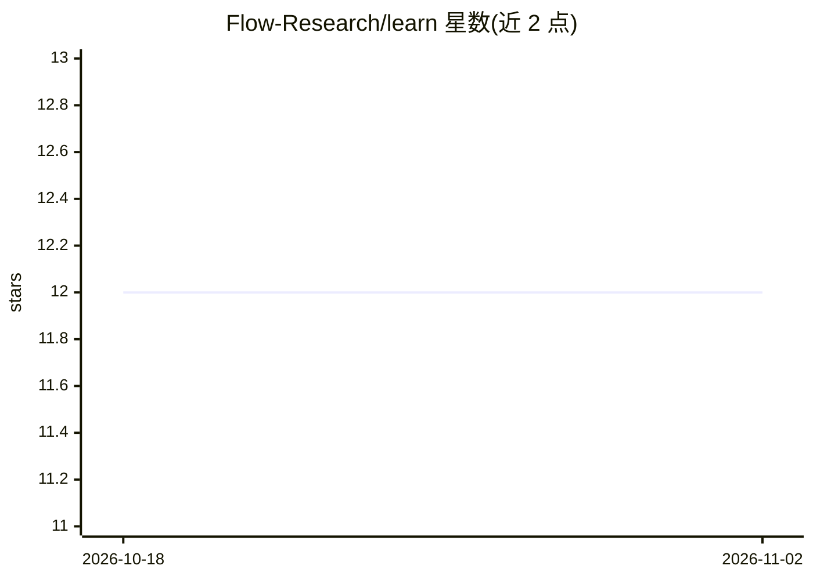

# Flow-Research/learn

⭐ 12 · Python · 推送 2026-07-29 · [GitHub](https://github.com/Flow-Research/learn) · [官网](https://learn.flowresearch.tech) · 组织维护

**面向工程师的 Flow Research 学习与知识库资源仓库**

Flow Research 维护的教育资源仓库，服务希望参与其产品（面向个人与企业的 Personal Operators）开发的工程师。包含结构化课程与产品文档（curriculum）、团队资源共享页、博客文章草稿库（knowledge-base）、基于 Docusaurus 的文档站点（learn.flowresearch.tech），以及 AI 辅助内容生成脚本（scripts）。网站可通过 npm 安装依赖并本地运行开发服务器或构建生产版本。

## 筛选速览

| 维度 | 判定 | 备注 |
|---|---|---|
| AI 角色 | `ai-knowledge` | 知识聚合/清单类 |
| 许可风险 | `none` | — |
| 部署形态 | `library` | 以包/库形式分发 |
| 模型依赖 | — | README 未给出锁定关系 |
| 硬件要求 | — | 无带数字的原话,不猜 |
| 安装摩擦 | `low` | 无编译、无系统依赖或容器化 |
| 成熟度 | — | 结构信号不足 |

## 能力要点

- curriculum 提供结构化课程、产品文档与贡献指南
- knowledge-base 保存博客文章草稿
- Docusaurus 前端网站（learn.flowresearch.tech）
- scripts 提供 AI 辅助内容生成工具

## 适用场景

- 工程师学习并准备参与 Flow Research 产品开发
- 团队成员共享与查找内部资源页面
- 浏览 Flow Research 的博客与知识文章

## 场景标签

`教程课程` · 领域:学习与行业

## 证据(README 行号)

> L3: Learning resource for engineers who want to contribute to building Flow Research's products — Personal Operators for
> L12: scripts/          AI-assisted content generation tools

## 星数曲线

2026-10-18 12 → 2026-11-02 12（+0）

---
*卡片 v1 · prompt 1.4 · 生成 2026-11-01 · 置信度 mid · 依据 README sha `069282281bfe` · [字段定义](../../DATASET.md)*
