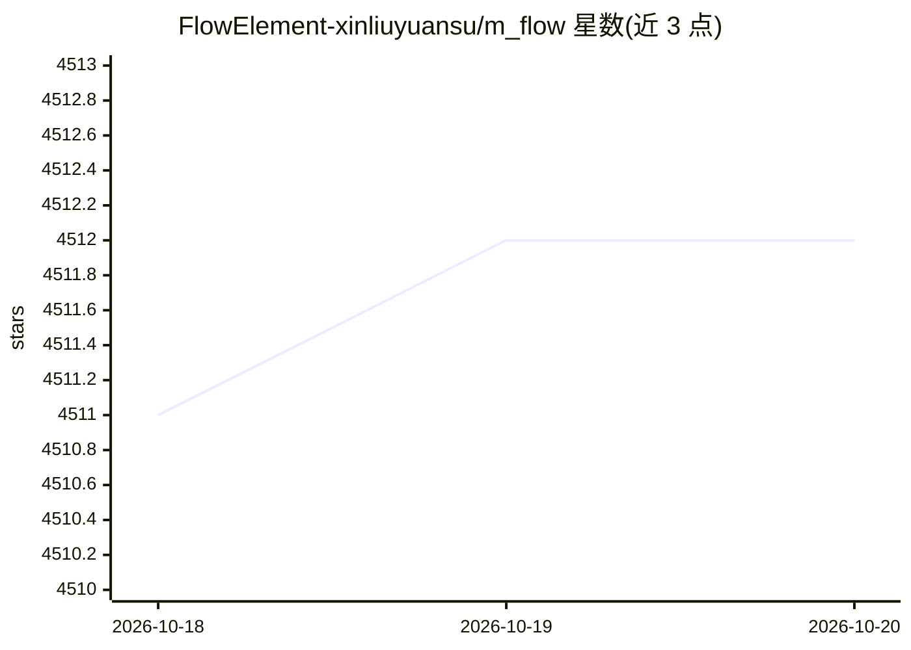

# FlowElement-xinliuyuansu/m_flow

⭐ 4,512 · Python · Apache-2.0 · 推送 2026-09-01 · [GitHub](https://github.com/FlowElement-xinliuyuansu/m_flow) · [官网](https://flowelement.ai) · 组织维护

**给 LLM/Agent 的认知记忆引擎：以四层锥形图做路径成本检索**

面向 RAG 与 Agent 记忆场景的认知记忆引擎：将知识组织为 Episode→Facet→FacetPoint→Entity 四层锥形图，检索时向量搜索仅作为入口，最终相关性由图上证据路径传播与路径成本评分决定，返回按最强证据链评分的 Episode 包。摄取阶段先做指代消解再入图，支持按人脸识别路由到不同人的记忆分区，并提取可复用的程序性记忆模式。报告了 LoCoMo-10 基准结果。以 Python 项目提供，含源码安装、PyPI 与 Docker 途径。

## 筛选速览

| 维度 | 判定 | 备注 |
|---|---|---|
| AI 角色 | `ai-ecosystem` | LLM/agent 周边工具 |
| 许可风险 | `permissive` | Apache-2.0 |
| 部署形态 | `self-host` | docker 或自建部署 |
| 模型依赖 | — | README 未给出锁定关系 |
| 硬件要求 | — | 无带数字的原话,不猜 |
| 安装摩擦 | `low` | 无编译、无系统依赖或容器化 |
| 成熟度 | — | 结构信号不足 |

## 能力要点

- 四层锥形图（Episode/Facet/FacetPoint/Entity）统一多粒度检索
- 相关性由图上证据路径传播与路径成本评分决定，向量搜索仅作入口
- 摄取前指代消解，代词解析为具体实体后入图
- 可选人脸识别路由实现多人记忆分区隔离

## 适用场景

- 为 Agent / LLM 对话系统提供带结构的长期记忆
- 替代相似度检索，按证据链定位相关上下文
- 多用户场景下按人脸隔离各自的记忆分区

## 场景标签

`Agent 记忆` `知识图谱` · 领域:Agent 开发

## 证据(README 行号)

> L27: M-flow takes a different approach: the graph is the scoring engine. When a query arrives, vector search casts a wid
> L68: M-flow organizes knowledge into a four-level **Cone Graph** — a layered hierarchy from abstract summaries to atomic

## 星数曲线

2026-10-18 4,511 → 2026-10-20 4,512（+1）

---
*卡片 v1 · prompt 1.4 · 生成 2026-10-20 · 置信度 high · 依据 README sha `56a5f1b827e4` · [字段定义](../../DATASET.md)*
