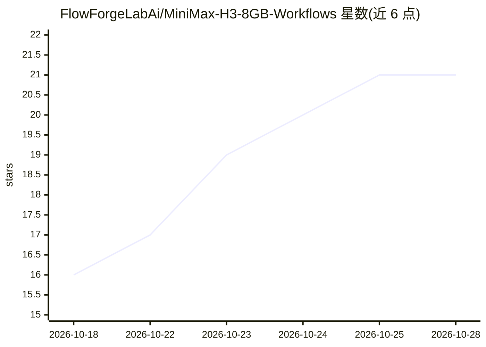

# FlowForgeLabAi/MiniMax-H3-8GB-Workflows

⭐ 21 · MIT · 推送 2026-10-24 · [GitHub](https://github.com/FlowForgeLabAi/MiniMax-H3-8GB-Workflows) · 组织维护 · 中文 README

**面向 8GB 笔记本 GPU 的 MiniMax H3 ComfyUI 三档工作流与实测指南**

提供三份可直接拖入 ComfyUI 的 MiniMax H3 图生视频工作流（20/8/4 步），针对 8GB 显存笔记本 GPU 调参，附 10 秒成片实测耗时。内容覆盖所需模型文件清单与量化格式选择（int8/nvfp4）、启动参数（必须 --disable-pinned-memory，禁用 sage/flash/--fast）、提示词结构与三个常见错误、官方分辨率硬约束与百万像素陷阱、每次运行前重启 ComfyUI 的实测依据（掉速 20 倍），以及 SaveVideo 奇数尺寸失败的排查。另附生态缺口统计与证据仓库链接。

## 筛选速览

| 维度 | 判定 | 备注 |
|---|---|---|
| AI 角色 | `ai-knowledge` | 知识聚合/清单类 |
| 许可风险 | `permissive` | MIT |
| 部署形态 | `None` |  |
| 模型依赖 | — | README 未给出锁定关系 |
| 硬件要求 | `gpu-8g` | |
| 安装摩擦 | `medium` | 含编译或系统依赖之一 |
| 成熟度 | `idea` | |

## 能力要点

- 三档工作流（20/8/4 步）含同 seed 实测耗时对比
- 启动参数与注意力后端选择的实测依据（comfy-kitchen vs sage vs SDPA）
- 分辨率硬约束表：短边≤768、面积≤768×1344、32 倍数
- 重启 ComfyUI 前后每 block 耗时 0.9-6 秒 vs 212 秒的实测数据

## 适用场景

- 在 8GB 显存笔记本上跑 MiniMax H3 图生视频
- 选择量化模型文件并正确摆放目录
- 排查掉速、全黑帧、奇数尺寸输出失败等问题

## 场景标签

`视频生成` · 领域:内容生成

## 证据(README 行号)

> L5: 三档可直接运行的 ComfyUI 工作流，针对 **8 GB 显存的笔记本 GPU** 调过。
> L6: 每个参数的选择都有实测依据，出处见文末。

## 星数曲线

2026-10-18 16 → 2026-10-28 21（+5）

---
*卡片 v1 · prompt 1.4 · 生成 2026-10-28 · 置信度 high · 依据 README sha `602ce556df56` · [字段定义](../../DATASET.md)*
