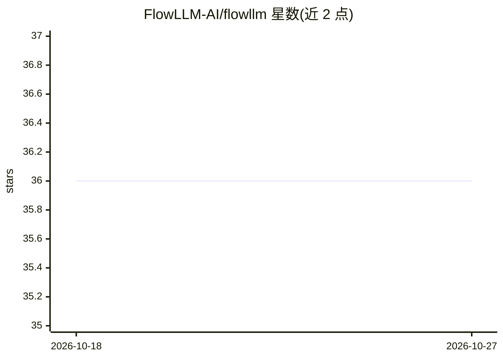

# FlowLLM-AI/flowllm

⭐ 36 · Python · Apache-2.0 · 推送 2026-06-27 · [GitHub](https://github.com/FlowLLM-AI/flowllm) · 组织维护 · 中文 README

**配置驱动的 LLM 应用框架：组织工作流与服务入口**

以 Service、Job、Step、Component 四层抽象组织的 LLM 应用开发框架：从 default.yaml 出发做配置驱动开发，任务支持同步、流式、后台与定时，可通过 HTTP 或 MCP 暴露；Steps、Services、Clients、LLM、Embeddings、Agent Wrappers 等组件经注册表 R 插拔扩展。CLI 命令直接映射同名服务端 Job，另提供 flowllm.lite 轻量 CLI 流。需 Python 3.11+，Roadmap 中的 Agent 集成与 TypeScript 前端为规划项。

## 筛选速览

| 维度 | 判定 | 备注 |
|---|---|---|
| AI 角色 | `ai-ecosystem` | LLM/agent 周边工具 |
| 许可风险 | `permissive` | Apache-2.0 |
| 部署形态 | `library` | 以包/库形式分发 |
| 模型依赖 | — | README 未给出锁定关系 |
| 硬件要求 | — | 无带数字的原话,不猜 |
| 安装摩擦 | `low` | 无编译、无系统依赖或容器化 |
| 成熟度 | — | 结构信号不足 |

## 能力要点

- Service/Job/Step/Component 四层抽象的统一调用路径
- 任务支持同步/流式/后台/定时，经 HTTP 或 MCP 暴露
- 组件经注册表 R 插拔（LLM、Embeddings、Agent Wrappers 等）
- flowllm.lite 提供免服务的最小 CLI 流（fl --action）

## 适用场景

- 用 YAML 配置快速搭建并通过 HTTP/MCP 暴露 LLM 工作流
- 把 LLM、Embedding、检索等能力注册为可复用组件
- 用脚本方式调用轻量 CLI 流处理简单任务

## 场景标签

`工作流自动化` · 领域:效率与自动化

## 证据(README 行号)

> L15: FlowLLM is a configuration-driven LLM application framework that organizes workflows, service entrypoints, and
> L23: - **Pluggable components**: Extend Steps, Services, Clients, LLMs, Embeddings, Embedding Stores, and Agent Wrappers

## 星数曲线

2026-10-18 36 → 2026-10-27 36（+0）

---
*卡片 v1 · prompt 1.4 · 生成 2026-10-25 · 置信度 high · 依据 README sha `3e00ace9c9c7` · [字段定义](../../DATASET.md)*
