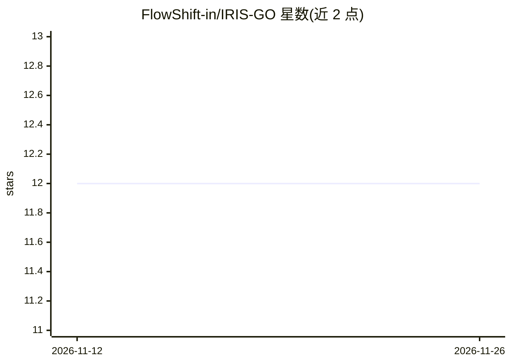

# FlowShift-in/IRIS-GO

⭐ 12 · TypeScript · 推送 2026-06-22 · [GitHub](https://github.com/FlowShift-in/IRIS-GO) · 个人维护

**本地多智能体编排系统：一条消息驱动 AI 团队执行系统级任务**

IRIS GO 是一个本地优先的开源多智能体编排系统，由 Master Agent 将任务路由到浏览器、文件、系统、编码、研究等专业子智能体，异步并行执行并可自纠错。接入方式覆盖 CLI、Web 仪表盘、WhatsApp/移动端。技术栈为 Next.js + Express/TypeScript + LangChain/LangGraph + PinchTab 浏览器控制，AI 模型采用 BYOK（OpenAI/Gemini/Ollama），通过 Docker Compose 一键部署。注意：Roadmap 中多数核心智能体与部署项仍为未完成状态，项目处于按教程系列公开构建阶段。

## 筛选速览

| 维度 | 判定 | 备注 |
|---|---|---|
| AI 角色 | `ai-ecosystem` | LLM/agent 周边工具 |
| 许可风险 | `permissive` | — |
| 部署形态 | `self-host` | docker 或自建部署 |
| 模型依赖 | local-ok | 支持本地模型 |
| 硬件要求 | — | 无带数字的原话,不猜 |
| 安装摩擦 | `low` | 无编译、无系统依赖或容器化 |
| 成熟度 | `idea` | |

## 能力要点

- 6 个专业子智能体（浏览器/文件/OS/编码/研究）由 Master Agent 路由调度
- 基于 LangGraph 的异步并行、有状态、自纠错执行
- BYOK 模型接入：OpenAI、Gemini、Groq 或本地 Ollama
- Docker Compose 一键部署，支持本机/AWS/VPS

## 适用场景

- 用自然语言驱动智能体完成克隆站点、部署等系统级工作流
- 在本地运行多智能体且数据不出机器
- 通过 WhatsApp/移动端/仪表盘远程下发与监控任务

## 场景标签

`多智能体` · 领域:Agent 开发

## 证据(README 行号)

> L29: While every other AI tool talks, IRIS GO acts. It is a fully local multi-agent orchestration system where a **Maste
> L69: AI Brain      →  LangChain + LangGraph (Multi-Agent · Async · Stateful)
> L72: AI Model      →  BYOK (OpenAI · Gemini · Ollama · No lock-in)

## 星数曲线

2026-11-12 12 → 2026-11-26 12（+0）

---
*卡片 v1 · prompt 1.4 · 生成 2026-11-18 · 置信度 mid · 依据 README sha `d7176fb21159` · [字段定义](../../DATASET.md)*
