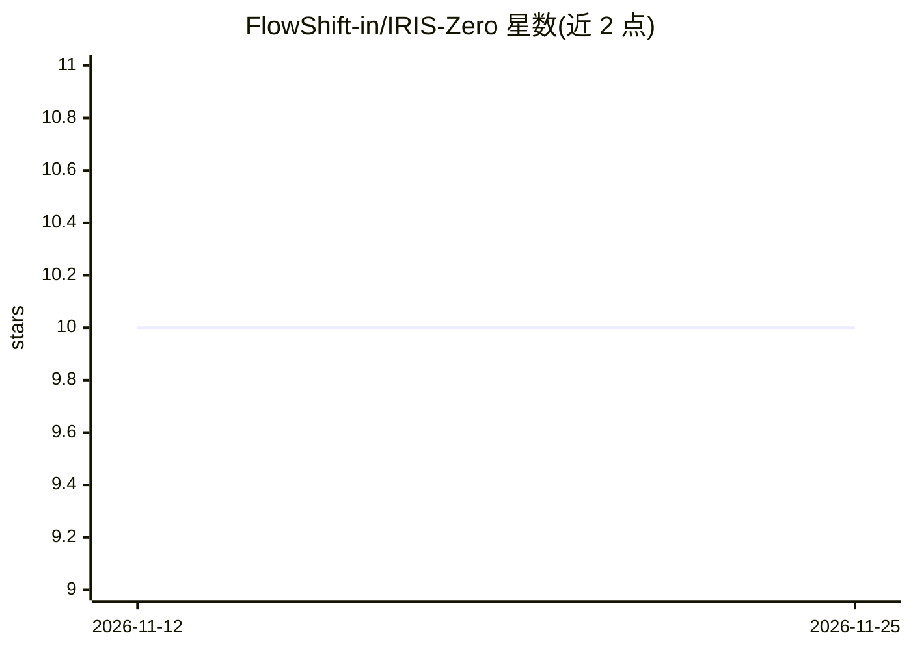

# FlowShift-in/IRIS-Zero

⭐ 10 · TypeScript · 推送 2026-06-11 · [GitHub](https://github.com/FlowShift-in/IRIS-Zero) · 个人维护

**本地隐私优先的 AI 终端代理：语音+命令行直接执行任务**

基于 Node.js/TypeScript 的本地 AI 命令行运行时，非聊天机器人定位：通过 Ollama 运行本地 LLM 做推理与命令生成，Whisper 做本地语音转文字，Kokoro.js 做本地语音输出，直接在本机 shell 与文件系统执行命令、管理项目与文件。全程无云端调用、无遥测、无 API key，可完全离线运行。安装方式为 git clone 后 npm install；路线图中 Windows/Linux 支持尚为待办，暗示当前平台支持有限。面向开发者与隐私优先用户。

## 筛选速览

| 维度 | 判定 | 备注 |
|---|---|---|
| AI 角色 | `ai-native` | 本体是模型或模型工具 |
| 许可风险 | `none` | — |
| 部署形态 | `library` | 以包/库形式分发 |
| 模型依赖 | local-ok | 支持本地模型 |
| 硬件要求 | — | 无带数字的原话,不猜 |
| 安装摩擦 | `low` | 无编译、无系统依赖或容器化 |
| 成熟度 | — | 结构信号不足 |

## 能力要点

- Ollama 本地 LLM 推理 + Whisper 本地语音输入 + Kokoro.js 本地语音输出，全链路离线
- 自然语言直接执行终端命令、Git 工作流、文件系统增删改查
- 零 API、零遥测、零 API key 的本地隐私设计
- 支持 Llama/Mistral/DeepSeek/Gemma 等任意 Ollama 模型

## 适用场景

- 离线环境下用语音或自然语言驱动终端完成任务
- 让 AI 直接在本机生成项目脚手架、修复构建错误、解释报错
- 不愿数据出本地的隐私优先开发工作流

## 场景标签

`AI 助手` · 领域:对话与助手

## 证据(README 行号)

> L25: It is a fully local AI command-line runtime built for real execution.
> L37: Powered by local AI models through Ollama, Whisper, and Kokoro.
> L186: Ollama

## 星数曲线

2026-11-12 10 → 2026-11-25 10（+0）

---
*卡片 v1 · prompt 1.4 · 生成 2026-11-20 · 置信度 high · 依据 README sha `db3811776160` · [字段定义](../../DATASET.md)*
