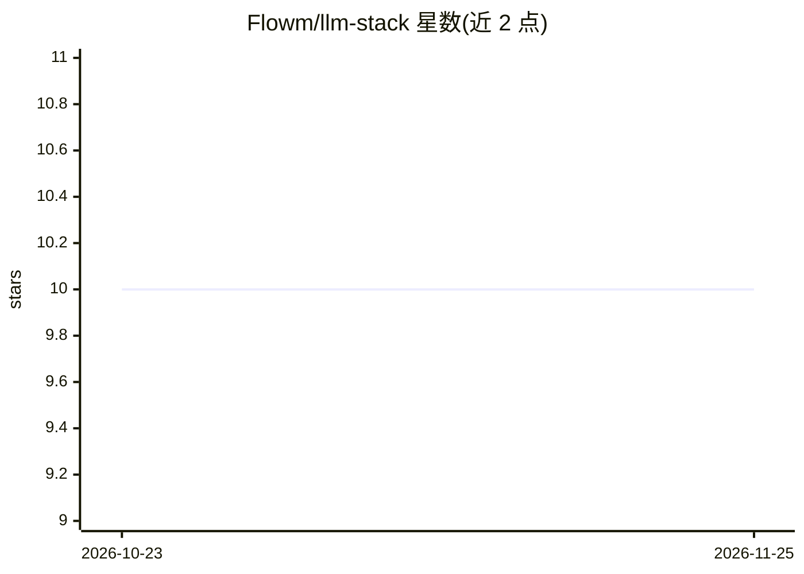

# Flowm/llm-stack

⭐ 10 · Python · MIT · 推送 2026-09-07 · [GitHub](https://github.com/Flowm/llm-stack) · 个人维护

**本地与托管 LLM 的一体化 Docker Compose 部署配置**

以 Docker Compose 编排的多组件 LLM 访问栈：Caddy 作为统一入口，Ollama 提供本地模型，LiteLLM 充当 OpenAI 兼容 API 代理，统一转发本地 Ollama 模型与 OpenAI、Google、Anthropic、Groq 等上游模型；前端提供 Open WebUI 与 AnythingLLM 两种 ChatGPT 风格聊天界面。安装需先安装 Docker、Docker Compose 与 Git，克隆仓库、复制并编辑 .env 填入 API key 后以 docker-compose up 启动，通过 Caddy 访问。

## 筛选速览

| 维度 | 判定 | 备注 |
|---|---|---|
| AI 角色 | `ai-ecosystem` | LLM/agent 周边工具 |
| 许可风险 | `permissive` | MIT |
| 部署形态 | `self-host` | docker 或自建部署 |
| 模型依赖 | local-ok | 支持本地模型 |
| 硬件要求 | — | 无带数字的原话,不猜 |
| 安装摩擦 | `low` | 无编译、无系统依赖或容器化 |
| 成熟度 | — | 结构信号不足 |

## 能力要点

- Caddy 统一入口 + LiteLLM OpenAI 兼容代理，统一访问本地与上游模型
- Ollama 运行本地模型（gemma3、llama3-8b、qwen3-30b）
- 接入 OpenAI/Google/Anthropic/Groq 多家上游模型
- 提供 Open WebUI 与 AnythingLLM 两种聊天前端

## 适用场景

- 在一台机器上用 Docker 部署本地+云端 LLM 的统一访问入口
- 团队内部搭建多模型可切换的 ChatGPT 风格聊天界面
- 通过 LiteLLM 统一 API 代理管理多个模型来源

## 场景标签

`模型网关` `聊天机器人` · 领域:Agent 开发

## 证据(README 行号)

> L3: An all-in-one Docker Compose config for providing access to local and external LLMs with multiple chat interfaces.
> L9: * LiteLLM: OpenAI compatible API proxy for local Ollama provided models and upstream models

## 星数曲线

2026-10-23 10 → 2026-11-25 10（+0）

---
*卡片 v1 · prompt 1.4 · 生成 2026-11-20 · 置信度 high · 依据 README sha `1cc7e71cd11f` · [字段定义](../../DATASET.md)*
