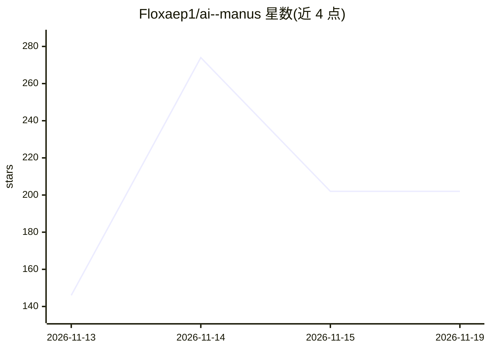

# Floxaep1/ai--manus

⭐ 202 · Apache-2.0 · 推送 2026-11-14 · [GitHub](https://github.com/Floxaep1/ai--manus) · 个人维护

**面向个人用户的自主 AI Agent：代跑代码与操控浏览器**

Manus 是一个自主式 AI Agent 系统，在沙箱环境中运行各类工具与操作：用户以自然语言下达任务，Agent 自行编写并执行脚本、打开网页、与页面元素交互、完成多步骤任务，并可在会话间复用已学到的流程。定位为家庭、学习与轻量办公场景的个人助手，面向无编程背景的普通用户。README 给出最低 4GB 内存、双核 CPU 的兼容性表格与使用步骤说明，但未提供任何安装命令、代码示例或技术实现细节。

## 筛选速览

| 维度 | 判定 | 备注 |
|---|---|---|
| AI 角色 | `ai-native` | 本体是模型或模型工具 |
| 许可风险 | `permissive` | Apache-2.0 |
| 部署形态 | `None` |  |
| 模型依赖 | — | README 未给出锁定关系 |
| 硬件要求 | — | 无带数字的原话,不猜 |
| 安装摩擦 | `low` | 无编译、无系统依赖或容器化 |
| 成熟度 | — | 结构信号不足 |

## 能力要点

- 自主执行代码与浏览器控制（导航网页、填表、采集信息）
- 代码与浏览器操作可在同一任务流中衔接
- 跨会话记忆工作流模式，重复任务无需重述
- 沙箱环境中运行工具与操作

## 适用场景

- 让 Agent 代为完成网页查资料、填表等重复操作
- 学生组织研究笔记、运行小脚本与快速计算
- 远程工作者从多个页面汇总数据、准备小型报告摘要

## 场景标签

`AI 助手` `浏览器自动化` `编码 Agent` · 领域:效率与自动化

## 证据(README 行号)

> L18: Manus is an autonomous AI agent designed to run code and control a browser on your behalf. Instead of acting like a
> L22: Manus is not a heavy studio suite or a complex enterprise platform. It is a focused helper built for home, study, a

## 星数曲线

2026-11-13 146 → 2026-11-19 202（+56）

---
*卡片 v1 · prompt 1.4 · 生成 2026-11-17 · 置信度 mid · 依据 README sha `4347b4dd3fa7` · [字段定义](../../DATASET.md)*
