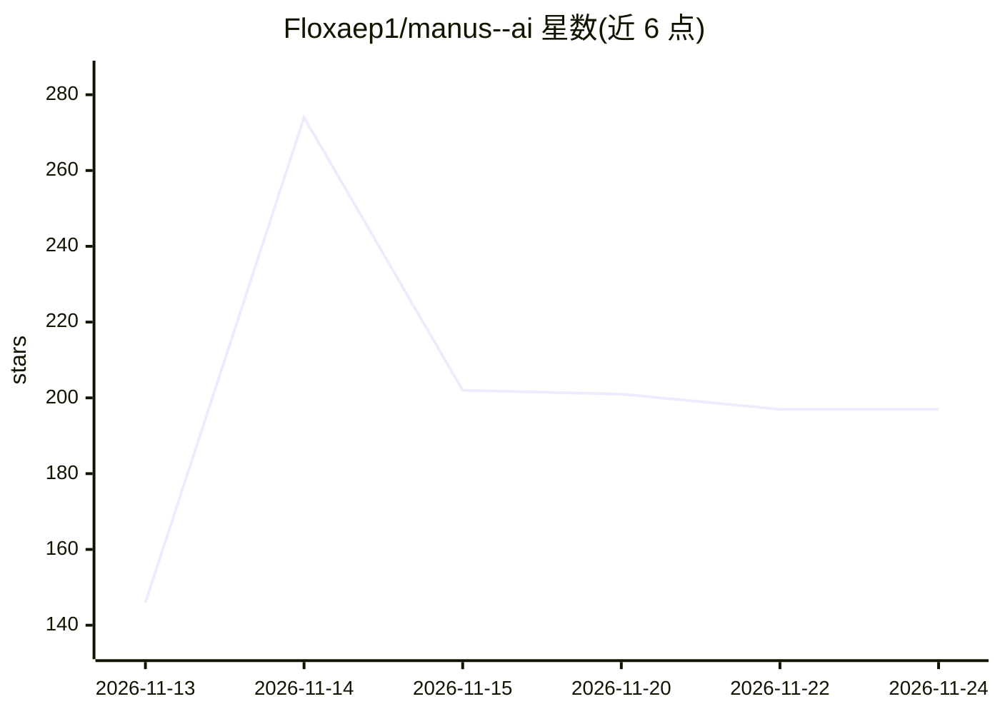

# Floxaep1/manus--ai

⭐ 193 · Apache-2.0 · 推送 2026-11-14 · [GitHub](https://github.com/Floxaep1/manus--ai) · 个人维护

**面向日常任务的自主 AI Agent：可执行代码并控制浏览器**

自述为自主 AI 代理系统，宣称能代用户编写并执行脚本、控制浏览器（导航网页、填写表单、抓取信息），并执行多步骤任务，定位为家庭、学习与轻量工作场景的个人助手，而非企业平台。README 为营销式描述，给出 CPU/内存等兼容性表格与使用步骤建议，但未提供任何安装命令、源码结构、技术架构或模型接入方式的说明；仓库主题标签提及 openai/anthropic/gemini 等，正文未展开。

## 筛选速览

| 维度 | 判定 | 备注 |
|---|---|---|
| AI 角色 | `ai-native` | 本体是模型或模型工具 |
| 许可风险 | `permissive` | Apache-2.0 |
| 部署形态 | `None` |  |
| 模型依赖 | — | README 未给出锁定关系 |
| 硬件要求 | — | 无带数字的原话,不猜 |
| 安装摩擦 | `low` | 无编译、无系统依赖或容器化 |
| 成熟度 | — | 结构信号不足 |

## 能力要点

- 自述支持自主代码执行与浏览器控制
- 定位家庭、学习与轻量办公的多步骤任务自动化
- README 提供最低/推荐硬件兼容性表格（双核 CPU、4GB 内存）

## 适用场景

- 让代理代为完成重复性的网页操作与脚本执行
- 学习与研究中整理资料、运行小脚本
- 轻量办公中跨多页面收集信息

## 场景标签

`AI 助手` `浏览器自动化` · 领域:效率与自动化

## 证据(README 行号)

> L10: - **Autonomous Code Execution:** Manus AI agent runs code on its own to complete tasks, so you can focus on decisio
> L18: Manus is an autonomous AI agent designed to run code and control a browser on your behalf. Instead of acting like a

## 星数曲线

2026-11-13 146 → 2026-11-24 197（+51）

---
*卡片 v1 · prompt 1.4 · 生成 2026-11-17 · 置信度 low · 依据 README sha `4347b4dd3fa7` · [字段定义](../../DATASET.md)*
