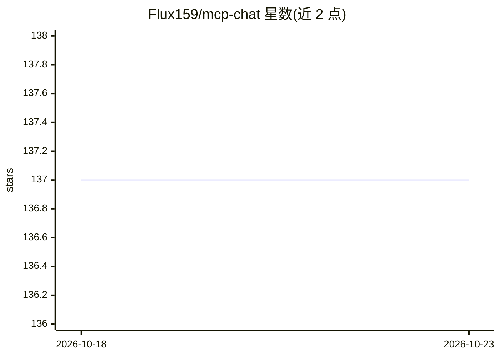

# Flux159/mcp-chat

⭐ 137 · TypeScript · MIT · 推送 2026-06-04 · [GitHub](https://github.com/Flux159/mcp-chat) · [官网](https://www.npmjs.com/package/mcp-chat) · 个人维护 · 中文 README

**通用 MCP 客户端：测试与评估 MCP 服务器和 agent**

开源的 MCP（Model Context Protocol）通用客户端，通过 npx 以 CLI 交互模式或 -p 传参方式连接任意 MCP 服务器（JS/Python/Docker），也可用 --web 在浏览器界面中聊天并动态配置服务器。面向 MCP 服务器开发者：可传入本地构建的 server 进行调试，在聊天中直接查看工具调用输出与参数。需设置 ANTHROPIC_API_KEY，目前仅支持 Anthropic 模型；聊天历史保存在 ~/.mcpchat/chats。开发基于 bun，提供 Docker 构建脚本。

## 筛选速览

| 维度 | 判定 | 备注 |
|---|---|---|
| AI 角色 | `ai-ecosystem` | LLM/agent 周边工具 |
| 许可风险 | `permissive` | MIT |
| 部署形态 | `desktop` | 安装包/桌面程序 |
| 模型依赖 | locked-api |  |
| 硬件要求 | — | 无带数字的原话,不猜 |
| 安装摩擦 | `low` | 无编译、无系统依赖或容器化 |
| 成熟度 | — | 结构信号不足 |

## 能力要点

- CLI 与 Web 两种模式连接任意 MCP 服务器
- 直接在聊天中查看工具调用输出与参数，辅助调试 MCP 服务器
- 可加载本地构建的 Node/Python MCP 服务器进行测试
- 支持 -m 选模型、--system 自定义系统提示词、环境变量透传

## 适用场景

- 我在开发 MCP 服务器时快速验证其工具调用行为
- 不想写代码就通过聊天界面试用某个 MCP 服务器
- 复用 claude_desktop_config.json 的配置直接测试已有服务器集合

## 场景标签

`聊天机器人` · 领域:对话与助手

## 证据(README 行号)

> L27: Open Source Generic MCP Client for testing & evaluating mcp servers and agents
> L71: - [x] Connect to any MCP server (JS, Python, Docker) in production or during development

## 星数曲线

2026-10-18 137 → 2026-10-23 137（+0）

---
*卡片 v1 · prompt 1.4 · 生成 2026-10-22 · 置信度 high · 依据 README sha `145edb3df2b6` · [字段定义](../../DATASET.md)*
