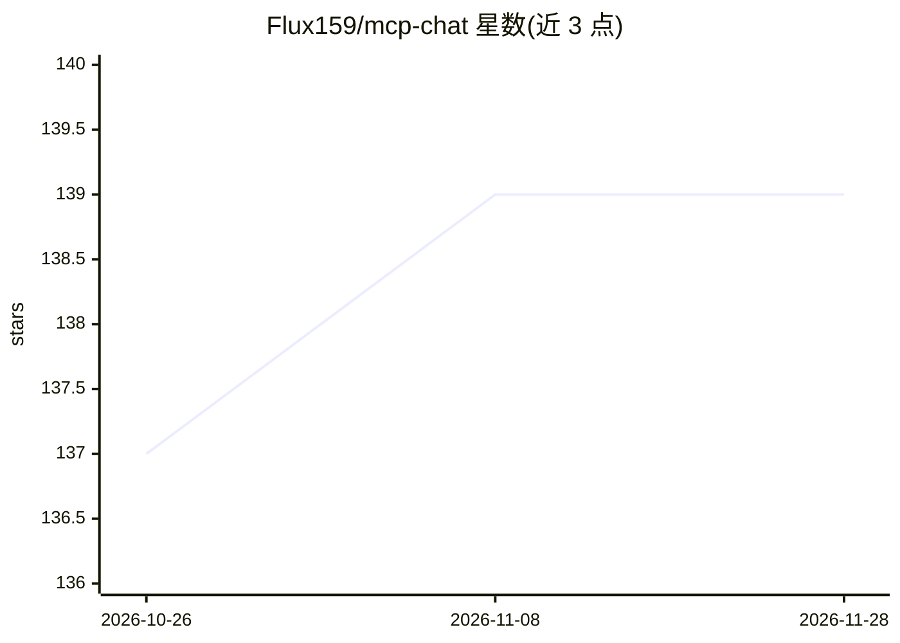

# Flux159/mcp-chat

⭐ 139 · TypeScript · MIT · 推送 2026-11-04 · [GitHub](https://github.com/Flux159/mcp-chat) · [官网](https://www.npmjs.com/package/mcp-chat) · 个人维护 · 中文 README

**测试与评估 MCP 服务器和 agent 的开源通用客户端**

面向 MCP 服务器与 agent 开发者的命令行/Web 客户端：通过 --server 参数连接本地或远程 MCP 服务器，与 LLM 对话并直接查看工具调用输出以调试服务器；支持 -p 直接传入 prompt、-m 选模型、--system 自定义系统提示词、--config 复用 claude_desktop_config.json，Web 模式下可在 UI 中动态配置服务器，聊天记录保存于 ~/.mcpchat/chats。当前仅支持 Anthropic 模型，需设置 ANTHROPIC_API_KEY；远程服务器支持 Streamable HTTP，不支持 SSE 与需认证的服务器。

## 筛选速览

| 维度 | 判定 | 备注 |
|---|---|---|
| AI 角色 | `ai-ecosystem` | LLM/agent 周边工具 |
| 许可风险 | `permissive` | MIT |
| 部署形态 | `desktop` | 安装包/桌面程序 |
| 模型依赖 | locked-api |  |
| 硬件要求 | — | 无带数字的原话,不猜 |
| 安装摩擦 | `low` | 无编译、无系统依赖或容器化 |
| 成熟度 | — | 结构信号不足 |

## 能力要点

- CLI 交互模式或 -p 直接传入 prompt，可查看工具调用输出与参数以调试 MCP 服务器
- Web 模式通过 UI 动态配置 MCP 服务器，聊天记录保存在 ~/.mcpchat/chats
- 支持连接 JS/Python/Docker 形式的 MCP 服务器及 Streamable HTTP 远程端点
- 支持自定义系统提示词、模型选择及环境变量透传给 MCP 服务器

## 适用场景

- 开发 MCP 服务器时测试本地构建的 Node/Python 服务器
- 通过 CLI 让 MCP 服务器执行任务（如列出 Kubernetes pods）并查看结果
- 用 Web 界面与多个 MCP 服务器聊天并保留历史记录

## 场景标签

 · 领域:LLM 基础设施/MCP 客户端

## 证据(README 行号)

> L27: Open Source Generic MCP Client for testing & evaluating mcp servers and agents
> L71: - [x] Connect to any MCP server (JS, Python, Docker) in production or during development
> L39: This will open up a chat prompt that you can use to interact with the servers and chat with an LLM.

## 星数曲线

2026-10-26 137 → 2026-11-28 139（+2）

---
*卡片 v1 · prompt 1.4 · 生成 2026-11-27 · 置信度 high · 依据 README sha `b196612c158c` · [字段定义](../../DATASET.md)*
