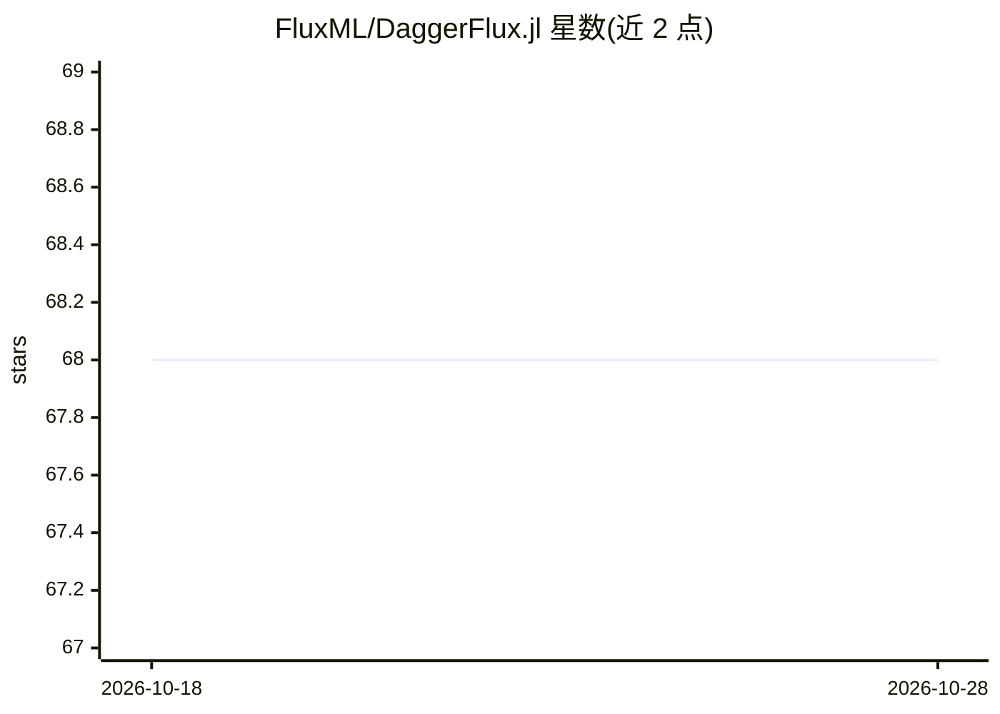

# FluxML/DaggerFlux.jl

⭐ 68 · Julia · NOASSERTION · 推送 2026-06-12 · [GitHub](https://github.com/FluxML/DaggerFlux.jl) · 组织维护

**Julia 包：为 Flux 模型提供跨多 worker/GPU 的分布式微分流水线**

Dagger.jl 与 Flux.jl 的早期集成包，通过 Dagger 的任务图调度将 Flux 模型的前向计算与 Zygote 微分流水线分布到多个 Julia worker、设备与 GPU 上，实现 Flux 模型的模型并行。使用时需以多 worker 启动 Julia 并保证 worker 可访问项目环境（如 addprocs 配合 --project），随后可用 Zygote.pullback 对分布在多 worker 上的模型求导并优化。README 自述处于早期阶段，欢迎贡献。

## 筛选速览

| 维度 | 判定 | 备注 |
|---|---|---|
| AI 角色 | `ai-ecosystem` | LLM/agent 周边工具 |
| 许可风险 | `none` | NOASSERTION |
| 部署形态 | `None` |  |
| 模型依赖 | — | README 未给出锁定关系 |
| 硬件要求 | — | 无带数字的原话,不猜 |
| 安装摩擦 | `low` | 无编译、无系统依赖或容器化 |
| 成熟度 | `idea` | |

## 能力要点

- 将 Dagger.jl 分布式调度与 Flux.jl 深度学习模型结合
- 支持多 worker、多设备、GPU 上的模型并行
- 可与 Zygote pullback 配合对整个分布模型求导优化

## 适用场景

- 让 Flux 模型在多 worker/多 GPU 上并行训练或求梯度
- 对超出单机规模的模型做模型并行切分
- Julia 生态下探索分布式自动微分流水线

## 场景标签

`模型训练` · 领域:训练与推理

## 证据(README 行号)

> L3: This is currently an early stage integration between `Dagger.jl` and `Flux.jl` to allow for distributed computation 
> L25: julia> y, back = Zygote.pullback((m,x) -> m(x), dc, ip)

## 星数曲线

2026-10-18 68 → 2026-10-28 68（+0）

---
*卡片 v1 · prompt 1.4 · 生成 2026-10-24 · 置信度 high · 依据 README sha `cdd55fcb2afd` · [字段定义](../../DATASET.md)*
