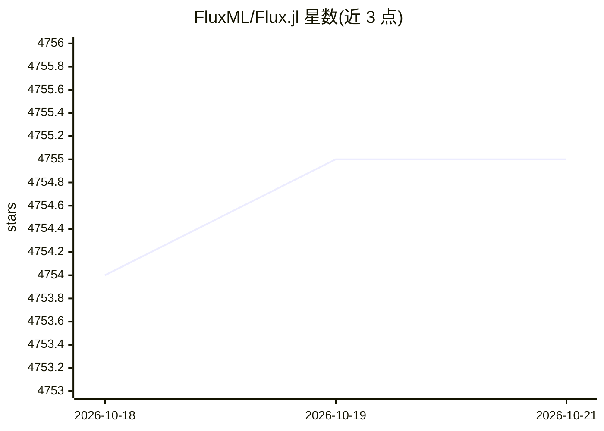

# FluxML/Flux.jl

⭐ 4,755 · Julia · NOASSERTION · 推送 2026-10-19 · [GitHub](https://github.com/FluxML/Flux.jl) · [官网](https://fluxml.ai/) · 组织维护

**纯 Julia 的深度学习库，提供轻量抽象与 GPU/AD 支持**

Flux 是 100% 纯 Julia 实现的机器学习库，在 Julia 原生 GPU 支持与自动微分（AD）之上提供轻量级抽象层。Flux 0.15 起几乎任何 Julia 参数化函数均可作为模型，可用内置层或自定义闭包构建模型。需 Julia 1.10 或更高版本，README 给出短示例代码，另有快速入门、文档与 model zoo 示例库；科研使用时请求引用其工作。

## 筛选速览

| 维度 | 判定 | 备注 |
|---|---|---|
| AI 角色 | `ai-native` | 本体是模型或模型工具 |
| 许可风险 | `none` | NOASSERTION |
| 部署形态 | `None` |  |
| 模型依赖 | — | README 未给出锁定关系 |
| 硬件要求 | — | 无带数字的原话,不猜 |
| 安装摩擦 | `low` | 无编译、无系统依赖或容器化 |
| 成熟度 | — | 结构信号不足 |

## 能力要点

- 100% 纯 Julia 技术栈
- 基于 Julia 原生 GPU 与自动微分支持的轻量抽象
- Flux 0.15 起任意 Julia 参数化函数均可作为模型
- 提供 model zoo 示例库

## 适用场景

- 用 Julia 编写与训练神经网络模型
- 构建可完全自定义 hack 的深度学习模型
- 科研场景中做机器学习实验并引用其成果

## 场景标签

`模型训练` · 领域:训练与推理

## 证据(README 行号)

> L5: Flux is an elegant approach to machine learning. It's a 100% pure-Julia stack, and provides lightweight abstractions
> L7: Works best with Julia 1.10 or later. Here's a very short example to try it out:

## 星数曲线

2026-10-18 4,754 → 2026-10-21 4,755（+1）

---
*卡片 v1 · prompt 1.4 · 生成 2026-10-20 · 置信度 high · 依据 README sha `993ec444851d` · [字段定义](../../DATASET.md)*
