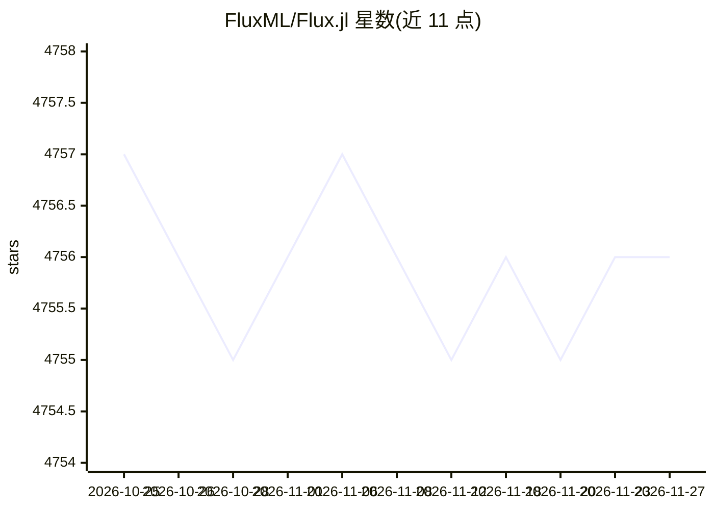

# FluxML/Flux.jl

⭐ 4,756 · Julia · NOASSERTION · 推送 2026-11-26 · [GitHub](https://github.com/FluxML/Flux.jl) · [官网](https://fluxml.ai/) · 组织维护

**Julia 机器学习库：构建与训练神经网络模型**

以纯 Julia 实现的机器学习库，在 Julia 原生 GPU 与自动微分支持之上提供轻量抽象。内置 MLP、卷积、循环与注意力等层及损失函数；自动微分引擎可选 Zygote、Enzyme 或 Mooncake；支持 NVIDIA/AMD/Apple 硬件，可通过 Reactant 编译为 XLA 程序在 CPU/GPU/TPU 上训练，并支持基于 MPI 与 NCCL 的分布式训练。需 Julia 1.10 及以上，通过 Julia REPL 的 Pkg 安装。

## 筛选速览

| 维度 | 判定 | 备注 |
|---|---|---|
| AI 角色 | `ai-native` | 本体是模型或模型工具 |
| 许可风险 | `none` | NOASSERTION |
| 部署形态 | `None` |  |
| 模型依赖 | — | README 未给出锁定关系 |
| 硬件要求 | — | 无带数字的原话,不猜 |
| 安装摩擦 | `medium` | 含编译或系统依赖之一 |
| 成熟度 | — | 结构信号不足 |

## 能力要点

- 支持 Zygote/Enzyme/Mooncake 三种自动微分引擎
- 支持 NVIDIA、AMD、Apple 硬件及 TPU（XLA 编译）
- 基于 MPI 与 NCCL 的分布式训练
- 模型为普通 Julia 代码，任意参数化函数均可作模型

## 适用场景

- 在 Julia 中搭建并训练神经网络
- 在 GPU/TPU 上训练与分布式训练模型
- 运行 ResNet、GPT-2 预训练等端到端示例

## 场景标签

`模型训练` · 领域:训练与推理

## 证据(README 行号)

> L5: Flux is an elegant approach to machine learning. It's a 100% pure-Julia stack, and provides lightweight abstractions
> L7: - **Layers and losses** for MLPs, convolutional, recurrent and attention models, with normalisation, pooling, embedd

## 星数曲线

2026-10-25 4,757 → 2026-11-27 4,756（-1）

---
*卡片 v1 · prompt 1.4 · 生成 2026-11-22 · 置信度 high · 依据 README sha `5742aa56d084` · [字段定义](../../DATASET.md)*
