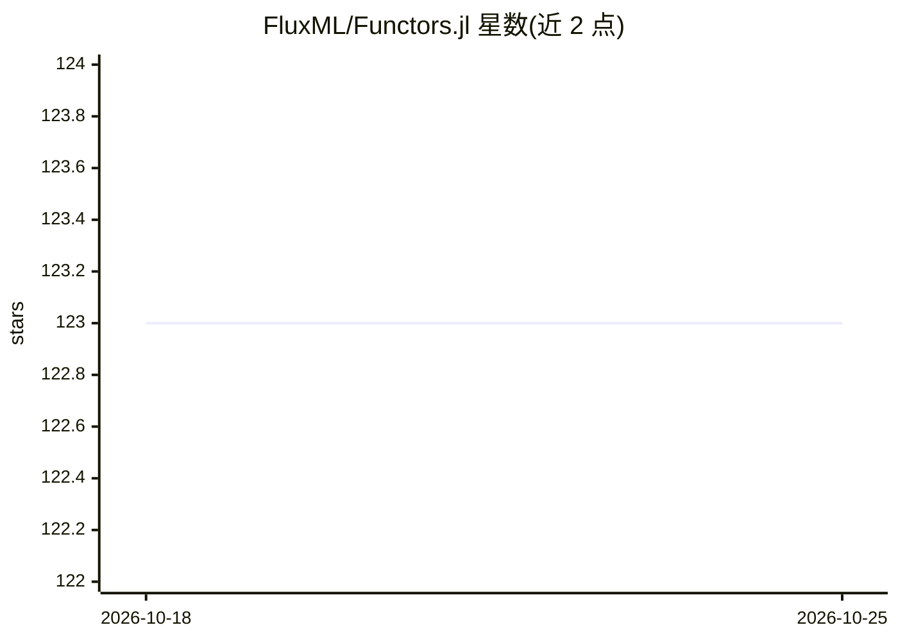

# FluxML/Functors.jl

⭐ 123 · Julia · MIT · 推送 2026-10-15 · [GitHub](https://github.com/FluxML/Functors.jl) · [官网](https://fluxml.ai/Functors.jl/stable/) · 组织维护

**Julia 库：对嵌套模型结构做参数级映射与重构**

面向机器学习与优化场景的 Julia 库，提供 fmap 作为“对参数做 map”的工具：对大型/深层嵌套模型结构递归遍历至叶节点，应用函数（如改变精度、优化器更新）后用 reconstruct 按原类型重构对象。底层函数 functor 返回可检查的子部分与重构函数；支持 @functor 指定字段、@leaf 排除遍历、exclude 细粒度控制及手工实现 functor。v0.5 起默认无需 @functor 即可递归遍历任意类型。供 Julia ML 生态的开发者使用。

## 筛选速览

| 维度 | 判定 | 备注 |
|---|---|---|
| AI 角色 | `ai-ecosystem` | LLM/agent 周边工具 |
| 许可风险 | `permissive` | MIT |
| 部署形态 | `None` |  |
| 模型依赖 | — | README 未给出锁定关系 |
| 硬件要求 | — | 无带数字的原话,不猜 |
| 安装摩擦 | `medium` | 含编译或系统依赖之一 |
| 成熟度 | — | 结构信号不足 |

## 能力要点

- fmap 递归遍历嵌套结构并对参数应用函数
- functor 返回子部分与类型保持的重构函数
- @functor 指定字段 / @leaf 排除遍历 / exclude 细粒度控制
- v0.5 起默认遍历任意类型，经 ConstructionBase 重构

## 适用场景

- 对深度嵌套模型统一改变参数精度
- 在优化器更新步骤中批量操作模型参数
- 自定义类型的结构化遍历与重构

## 场景标签

 · 领域:机器学习/编程库

## 证据(README 行号)

> L7: Functors.jl provides tools to express a powerful design pattern for dealing with large / nested structures, as in ma
> L11: Functors.jl provides `fmap` to make those things easy, acting as a 'map over parameters':

## 星数曲线

2026-10-18 123 → 2026-10-25 123（+0）

---
*卡片 v1 · prompt 1.4 · 生成 2026-10-23 · 置信度 high · 依据 README sha `40c47309337a` · [字段定义](../../DATASET.md)*
