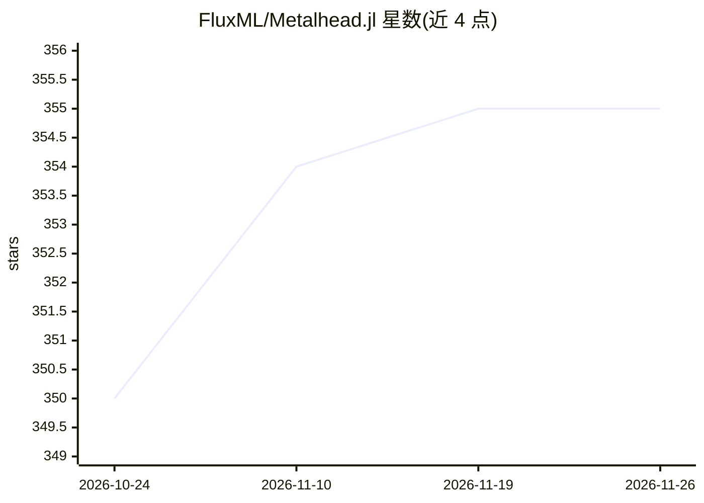

# FluxML/Metalhead.jl

⭐ 355 · Julia · NOASSERTION · 推送 2026-11-22 · [GitHub](https://github.com/FluxML/Metalhead.jl) · [官网](https://fluxml.ai/Metalhead.jl) · 组织维护

**Julia 语言的预训练模型库：经 Flux.jl 直接做视觉/文本/图像任务**

Metalhead.jl 将 Hugging Face Hub 上的预训练模型移植到 Flux.jl，覆盖视觉、语言、视觉-语言模型、文本嵌入、分割与图像生成/编辑。模型为 timm/transformers/diffusers/sentence-transformers 的纯 Julia 移植，不依赖 PyTorch/Python（仅文本分词经由 Python）。`create_model` 按 Hub 仓库名下载配置与 safetensors 权重并构建架构；移植结果与 PyTorch 输出做数值比对验证。需 Julia 1.10+，模型可在 CPU 或 GPU 上推理或微调。

## 筛选速览

| 维度 | 判定 | 备注 |
|---|---|---|
| AI 角色 | `ai-native` | 本体是模型或模型工具 |
| 许可风险 | `none` | NOASSERTION |
| 部署形态 | `None` |  |
| 模型依赖 | — | README 未给出锁定关系 |
| 硬件要求 | — | 无带数字的原话,不猜 |
| 安装摩擦 | `medium` | 含编译或系统依赖之一 |
| 成熟度 | — | 结构信号不足 |

## 能力要点

- 纯 Julia 实现，模型即普通 Flux 模型，可微调、可在 CPU/GPU 运行
- create_model/create_processor 按任意 Hub checkpoint 下载权重与预处理器
- 移植与 PyTorch 输出数值比对（float64 相对误差 1e-8，真实权重 1e-4）
- 覆盖 ResNet/ViT/Llama/Qwen/CLIP/SAM/FLUX.2 等模型家族

## 适用场景

- 在 Julia 项目中做图像分类、分割或零样本标注
- 用嵌入模型做文本语义检索与排序
- 在 Flux 生态中微调 Hugging Face Hub 上的预训练权重
- 从文本生成或编辑图像

## 场景标签

`图像生成` `语义搜索` `图像视频处理` `微调` · 领域:内容生成

## 证据(README 行号)

> L8: Metalhead.jl brings pretrained models from the Hugging Face Hub
> L29: - **Ordinary Flux models.** A model is a Flux model like any other: differentiable, ready

## 星数曲线

2026-10-24 350 → 2026-11-26 355（+5）

---
*卡片 v1 · prompt 1.4 · 生成 2026-11-25 · 置信度 high · 依据 README sha `a9122c6f299c` · [字段定义](../../DATASET.md)*
