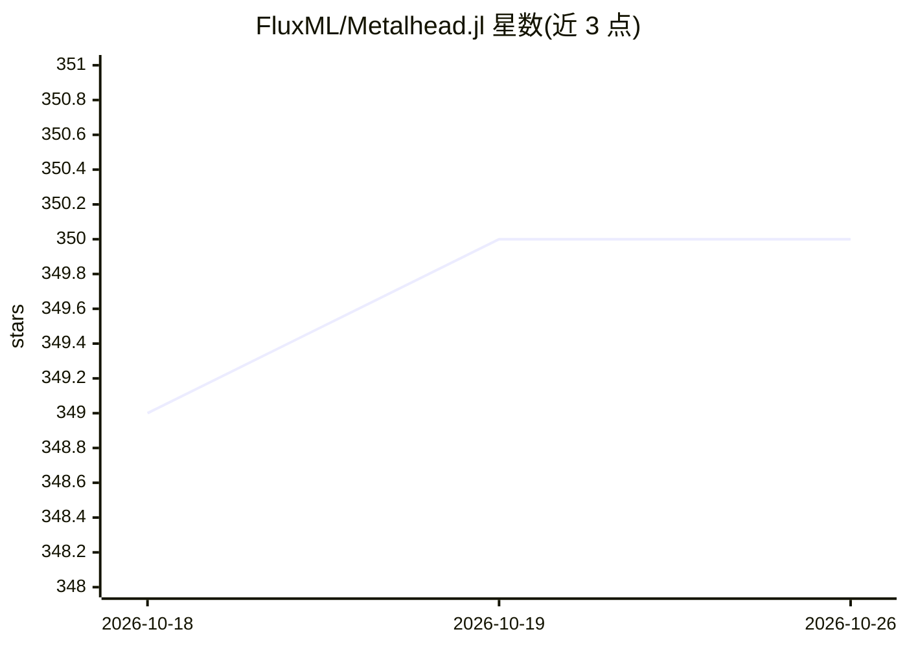

# FluxML/Metalhead.jl

⭐ 350 · Julia · NOASSERTION · 推送 2026-10-25 · [GitHub](https://github.com/FluxML/Metalhead.jl) · [官网](https://fluxml.ai/Metalhead.jl) · 组织维护

**Julia/Flux 的计算机视觉模型架构库：提供标准 CV 模型**

为 Flux.jl 生态提供标准机器学习视觉模型架构的 Julia 包：以纯 Flux 层实现 AlexNet、ResNet、ViT、UNet 等 20 余种图像分类与其他模型构造器，并在 Layers 模块中提供残差块、inception 块等构建块供组合更复杂模型。部分模型（ResNet/VGG/ViT 等）提供预训练权重，其余仅架构。通过 Julia 包管理器一行命令安装，面向使用 Flux.jl 的机器学习开发者。

## 筛选速览

| 维度 | 判定 | 备注 |
|---|---|---|
| AI 角色 | `ai-native` | 本体是模型或模型工具 |
| 许可风险 | `none` | NOASSERTION |
| 部署形态 | `None` |  |
| 模型依赖 | — | README 未给出锁定关系 |
| 硬件要求 | — | 无带数字的原话,不猜 |
| 安装摩擦 | `low` | 无编译、无系统依赖或容器化 |
| 成熟度 | — | 结构信号不足 |

## 能力要点

- 纯 Flux 层实现 20 余种标准 CV 架构（AlexNet 到 ViT、UNet）
- Layers 模块提供残差块/inception 块等可复用构建块
- 部分模型（ResNet、ResNeXt、SqueezeNet、WideResNet、VGG、ViT）提供预训练权重
- 通过 Julia Pkg 一行命令安装

## 适用场景

- 在 Flux.jl 中搭建图像分类模型并加载预训练权重
- 复用残差块、inception 块等构建块组装自定义视觉模型
- 作为 Julia 生态的标准视觉模型架构参考实现

## 场景标签

 · 领域:计算机视觉/深度学习

## 证据(README 行号)

> L8: Metalhead.jl provides standard machine learning vision models for use with Flux.jl. The architectures in this packag
> L45: |ResNet|`ResNet`|Y|

## 星数曲线

2026-10-18 349 → 2026-10-26 350（+1）

---
*卡片 v1 · prompt 1.4 · 生成 2026-10-21 · 置信度 high · 依据 README sha `26aee8789c7d` · [字段定义](../../DATASET.md)*
