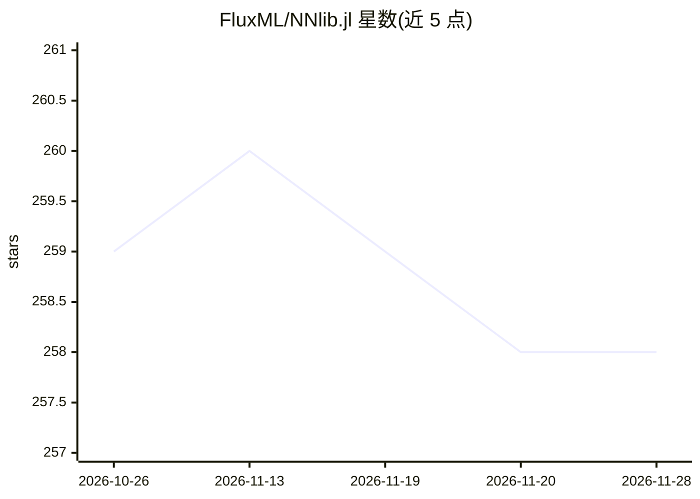

# FluxML/NNlib.jl

⭐ 258 · Julia · NOASSERTION · 推送 2026-11-25 · [GitHub](https://github.com/FluxML/NNlib.jl) · 组织维护

**Julia 神经网络基础函数库，供 Flux 等使用**

NNlib.jl 是一个 Julia 库，提供神经网络常用基础函数，包括 softmax、sigmoid、批量乘法、卷积和池化等，并为这些函数定义自动微分所需的梯度规则。Flux.jl 加载此包使用这些函数，但本包也可独立使用。AD 支持分两档：Zygote.jl 与 Enzyme.jl 为第一档（有梯度测试），Mooncake.jl 为实验性第二档。GPU 支持通过包扩展提供，导入 CUDA/cuDNN 或 AMDGPU 即可加载对应后端。

## 筛选速览

| 维度 | 判定 | 备注 |
|---|---|---|
| AI 角色 | `ai-native` | 本体是模型或模型工具 |
| 许可风险 | `none` | NOASSERTION |
| 部署形态 | `None` |  |
| 模型依赖 | — | README 未给出锁定关系 |
| 硬件要求 | — | 无带数字的原话,不猜 |
| 安装摩擦 | `medium` | 含编译或系统依赖之一 |
| 成熟度 | — | 结构信号不足 |

## 能力要点

- 提供 softmax、sigmoid、批量乘法、卷积、池化等神经网络基础函数
- 为各函数定义自动微分梯度规则，支持 Zygote/Enzyme/Mooncake
- GPU 支持通过包扩展加载 CUDA/cuDNN 与 AMDGPU 后端
- 被 Flux.jl 使用，也可独立使用

## 适用场景

- 在 Julia 中直接调用神经网络原语函数
- 为 Flux.jl 模型提供底层算子与梯度规则
- 在 CUDA 或 AMDGPU 上运行卷积/池化等运算

## 场景标签

`模型训练` · 领域:训练与推理

## 证据(README 行号)

> L7: This package provides a library of functions useful for neural networks, such as softmax, sigmoid, batched multiplic
> L14: GPU support is provided as package extensions (see the `ext/` folder). In order to load the extensions, use the imp

## 星数曲线

2026-10-26 259 → 2026-11-28 258（-1）

---
*卡片 v1 · prompt 1.4 · 生成 2026-11-25 · 置信度 high · 依据 README sha `d388cf4cf029` · [字段定义](../../DATASET.md)*
