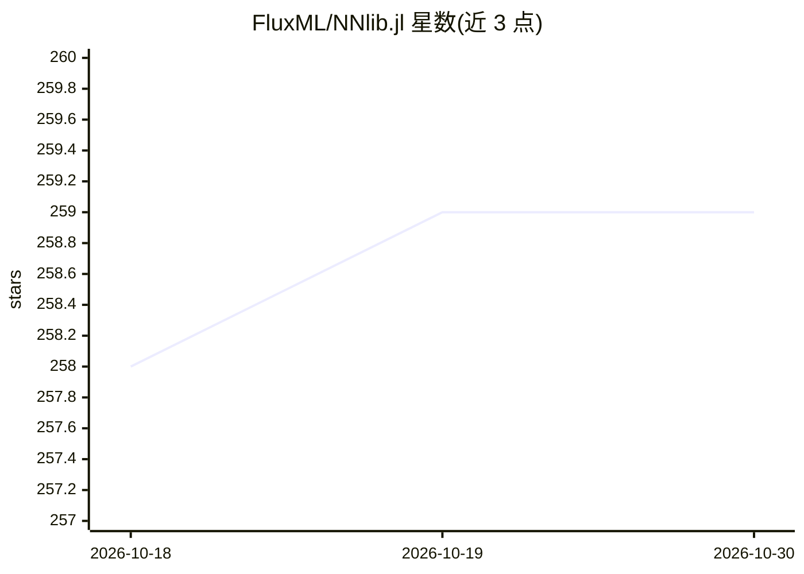

# FluxML/NNlib.jl

⭐ 259 · Julia · NOASSERTION · 推送 2026-10-28 · [GitHub](https://github.com/FluxML/NNlib.jl) · 组织维护

**Julia 神经网络基础算子库，供 Flux.jl 等加载使用**

NNlib.jl 是 Julia 语言的神经网络基础函数库，提供 softmax、sigmoid、批量矩阵乘法、卷积与池化等算子。Flux.jl 加载并使用其中多数函数，该库也可独立使用。通过 ChainRules.jl 定义梯度，供 Zygote.jl 等自动微分包使用。GPU 支持以包扩展形式提供，导入 CUDA/cuDNN 或 AMDGPU 即可启用对应后端。

## 筛选速览

| 维度 | 判定 | 备注 |
|---|---|---|
| AI 角色 | `ai-ecosystem` | LLM/agent 周边工具 |
| 许可风险 | `none` | NOASSERTION |
| 部署形态 | `None` |  |
| 模型依赖 | — | README 未给出锁定关系 |
| 硬件要求 | — | 无带数字的原话,不猜 |
| 安装摩擦 | `medium` | 含编译或系统依赖之一 |
| 成熟度 | — | 结构信号不足 |

## 能力要点

- 提供 softmax、sigmoid、批量乘法、卷积、池化等神经网络基础函数
- 经 ChainRules.jl 定义梯度，供 Zygote.jl 等自动微分包使用
- GPU 支持以包扩展形式提供（CUDA/cuDNN、AMDGPU）
- 可被 Flux.jl 加载，也可独立使用

## 适用场景

- 为 Julia 神经网络项目提供基础算子
- 配合 Zygote.jl 做自动微分
- 在 CUDA 或 AMD GPU 上运行神经网络算子

## 场景标签

 · 领域:机器学习/神经网络库

## 证据(README 行号)

> L7: This package provides a library of functions useful for neural networks, such as softmax, sigmoid, batched multiplic
> L11: GPU support is provided as package extensions (see the `ext/` folder). In order to load the extensions, use the imp

## 星数曲线

2026-10-18 258 → 2026-10-30 259（+1）

---
*卡片 v1 · prompt 1.4 · 生成 2026-10-22 · 置信度 high · 依据 README sha `58f890f35b29` · [字段定义](../../DATASET.md)*
