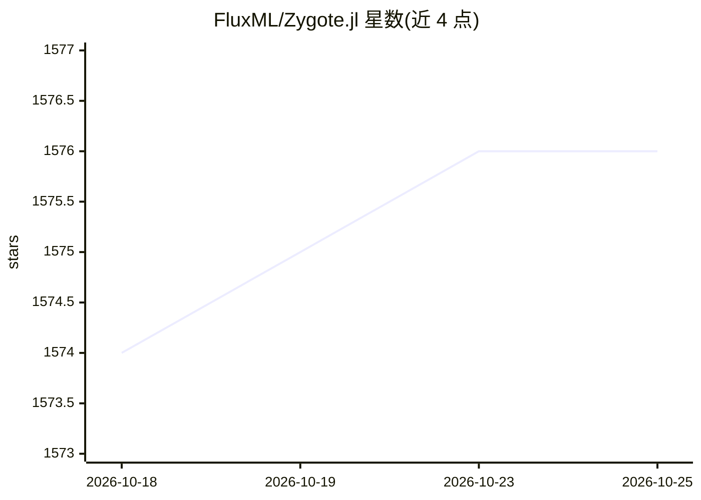

# FluxML/Zygote.jl

⭐ 1,576 · Julia · NOASSERTION · 推送 2026-10-22 · [GitHub](https://github.com/FluxML/Zygote.jl) · [官网](https://fluxml.ai/Zygote.jl/) · 组织维护

**Julia 语言的源到源自动微分库**

面向 Julia 开发者的源到源自动微分（AD）库，是 Flux 可微编程框架的下一代 AD 系统。它挂接 Julia 编译器生成反向传播代码，支持控制流、递归、闭包、结构体和字典等语言动态特性，可对整个模型（含嵌套参数结构）求梯度，自定义梯度通过 ChainRulesCore.jl 的 rrule 定义。限制：变异与异常处理暂不支持，隐式参数接口已标记弃用。要求 Julia 1.10 及以上。

## 筛选速览

| 维度 | 判定 | 备注 |
|---|---|---|
| AI 角色 | `ai-ecosystem` | LLM/agent 周边工具 |
| 许可风险 | `none` | NOASSERTION |
| 部署形态 | `None` |  |
| 模型依赖 | — | README 未给出锁定关系 |
| 硬件要求 | — | 无带数字的原话,不猜 |
| 安装摩擦 | `low` | 无编译、无系统依赖或容器化 |
| 成熟度 | — | 结构信号不足 |

## 能力要点

- 源到源 AD：挂接 Julia 编译器生成反向传播代码
- 支持控制流、递归、闭包、结构体、字典等语言动态特性
- 可对含嵌套结构的多参数整个模型求梯度
- 基于 ChainRules.jl 规则集，可通过 rrule 定义自定义梯度

## 适用场景

- 为 Julia 机器学习模型（如 Flux）计算梯度
- 在含控制流与递归的通用 Julia 代码上做自动微分
- 科研与数值计算中定义自定义梯度规则

## 场景标签

 · 领域:机器学习/科学计算基础设施

## 证据(README 行号)

> L7: Zygote provides source-to-source automatic differentiation (AD) in Julia, and is the next-gen AD system for the Flux
> L9: Zygote supports Julia 1.10 onwards.

## 星数曲线

2026-10-18 1,574 → 2026-10-25 1,576（+2）

---
*卡片 v1 · prompt 1.4 · 生成 2026-10-21 · 置信度 high · 依据 README sha `5db43d28c183` · [字段定义](../../DATASET.md)*
