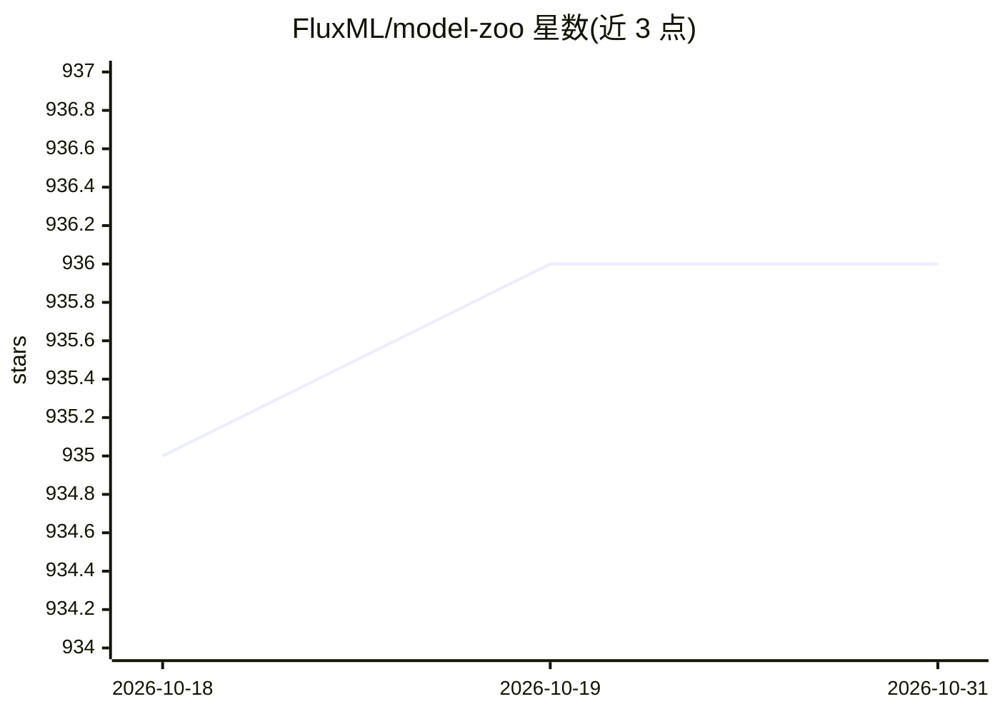

# FluxML/model-zoo

⭐ 936 · Julia · NOASSERTION · 推送 2026-07-01 · [GitHub](https://github.com/FluxML/model-zoo) · [官网](https://fluxml.ai/) · 组织维护

**Flux（Julia）机器学习库的模型示例集合**

由 FluxML 维护的 Julia Flux 深度学习库官方示例仓库：按 vision（CNN、VAE、GAN、扩散模型）、text（RNN、NanoGPT、情感分析）、other（逻辑回归、元学习等）分类收录可运行的模型示例，每个示例带独立 Julia 项目与 Manifest 文件锁定依赖版本。使用方式为在项目目录激活 Julia 环境并 instantiate，可用 include 逐行运行；多数模型默认支持通过 gpu 调用使用 NVIDIA CUDA。条目标注所适配的 Flux 版本（v0.6–v0.14），另含教程与指向 MLJFlux 的外部示例。

## 筛选速览

| 维度 | 判定 | 备注 |
|---|---|---|
| AI 角色 | `ai-knowledge` | 知识聚合/清单类 |
| 许可风险 | `none` | NOASSERTION |
| 部署形态 | `None` |  |
| 模型依赖 | — | README 未给出锁定关系 |
| 硬件要求 | — | 无带数字的原话,不猜 |
| 安装摩擦 | `medium` | 含编译或系统依赖之一 |
| 成熟度 | — | 结构信号不足 |

## 能力要点

- 按 vision/text/other 分类收录数十个可运行模型示例（LeNet、VGG、VAE、DCGAN、扩散模型、NanoGPT 等）
- 每个示例带独立 Julia 项目与 Manifest，锁定依赖精确版本
- 多数模型通过 gpu 调用默认支持 NVIDIA CUDA GPU 运行
- 条目标注适配的 Flux 版本（v0.6 至 v0.14）

## 适用场景

- 学习 Flux 库的各类模型写法与 API 用法
- 以现成示例为起点搭建自己的模型
- 在 Gitpod 在线环境中运行示例

## 场景标签

`教程课程` · 领域:学习与行业

## 证据(README 行号)

> L3: This repository contains various demonstrations of the Flux machine learning library. Any of these may freely be use
> L5: The models are broadly categorised into the folders vision (e.g. large convolutional neural networks (CNNs)), text (
> L61: ## Examples in the Model Zoo

## 星数曲线

2026-10-18 935 → 2026-10-31 936（+1）

---
*卡片 v1 · prompt 1.4 · 生成 2026-10-21 · 置信度 high · 依据 README sha `0f054bf7a6d9` · [字段定义](../../DATASET.md)*
