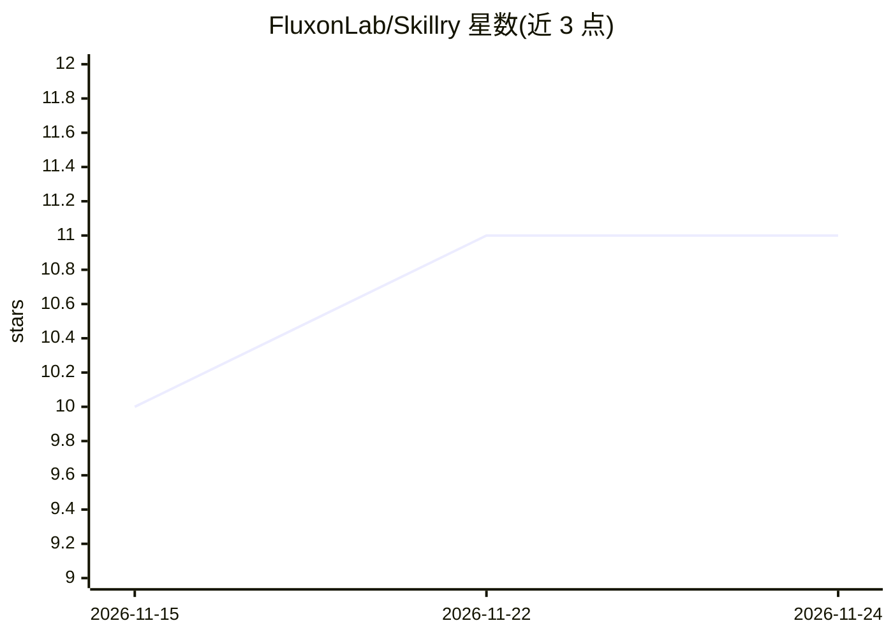

# FluxonLab/Skillry

⭐ 11 · Python · NOASSERTION · 推送 2026-11-23 · [GitHub](https://github.com/FluxonLab/Skillry) · [官网](https://fluxonlab.com) · 组织维护

**面向多平台 agent 运行时的可安装技能与子代理库**

从单一维护库为 Claude Code、OpenAI Codex、Cursor、GitHub Copilot、Google Antigravity 和 OpenCode 六个平台生成适配的技能与代理定义：65 个技能与 122 个代理按 18 个部门组织，通过 npx 便携安装器分发，默认 dry-run 预览、显式 --apply 才写入，支持按部门/技能选择性安装、doctor 校验与干净卸载。不修改项目自身的 CLAUDE.md/AGENTS.md 等指令文件；社区第三方内容带上游署名与许可。MIT 许可，需 Node.js >= 16、Git、Python 3。

## 筛选速览

| 维度 | 判定 | 备注 |
|---|---|---|
| AI 角色 | `ai-ecosystem` | LLM/agent 周边工具 |
| 许可风险 | `permissive` | NOASSERTION |
| 部署形态 | `library` | 以包/库形式分发 |
| 模型依赖 | — | README 未给出锁定关系 |
| 硬件要求 | — | 无带数字的原话,不猜 |
| 安装摩擦 | `low` | 无编译、无系统依赖或容器化 |
| 成熟度 | — | 结构信号不足 |

## 能力要点

- dry-run 优先安装器：预览写入计划后经 --apply 显式应用
- 为 6 个平台适配技能与代理定义，含 Copilot 原生代理格式
- 最小权限代理边界与第三方内容上游署名
- skillry doctor 校验安装文件与清单一致性

## 适用场景

- 为 Claude Code/Codex 等运行时按需安装领域技能与子代理
- 团队统一维护跨多个 agent 平台的技能库
- 以最小权限方式隔离临时专家代理的并行工作

## 场景标签

`提示工程` · 领域:Agent 开发

## 证据(README 行号)

> L5: **Reusable, permission-bounded skills and agents for Claude Code, OpenAI Codex, Cursor, GitHub Copilot, Google Antig
> L83: - Platform-ready skills and agent definitions maintained from a shared library.
> L87: - A dry-run-first portable installer so users can inspect destinations and changes before writing.

## 星数曲线

2026-11-15 10 → 2026-11-24 11（+1）

---
*卡片 v1 · prompt 1.4 · 生成 2026-11-20 · 置信度 high · 依据 README sha `053d8b6a5425` · [字段定义](../../DATASET.md)*
