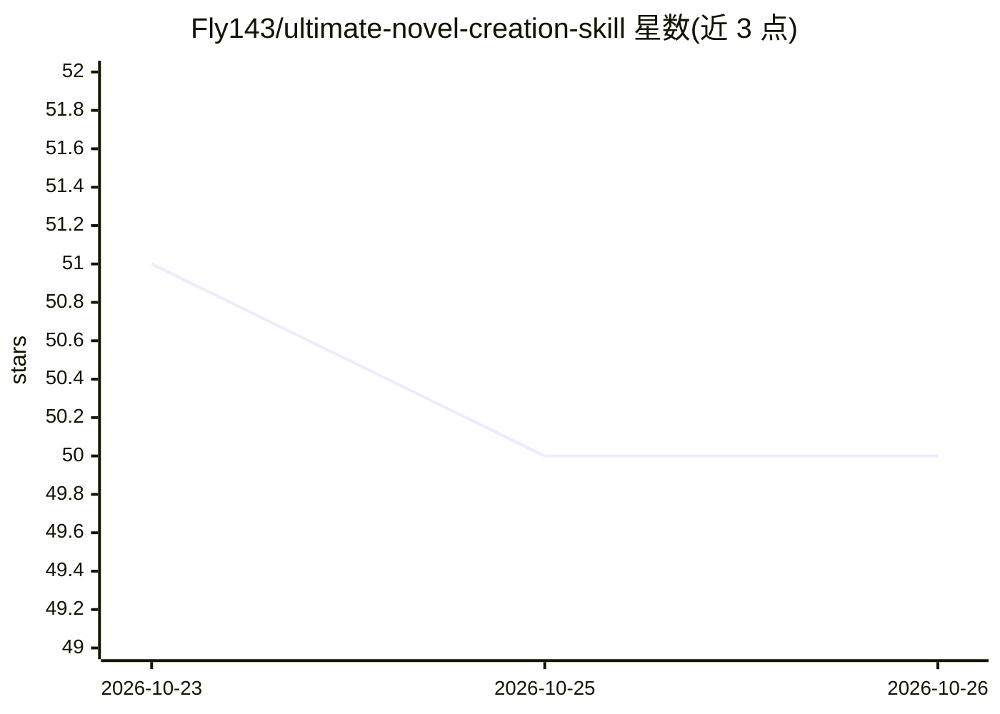

# Fly143/ultimate-novel-creation-skill

⭐ 50 · PowerShell · 推送 2026-10-22 · [GitHub](https://github.com/Fly143/ultimate-novel-creation-skill) · 个人维护 · 中文 README

**AI Agent 长篇小说创作技能包：从立项到千章完稿全流程**

以 SKILL.md 形式提供的内容包，加载到宿主 AI Agent（需将 system_prompt.md 配为 system prompt）后，通过触发词驱动 28 个功能模块：立项、世界观、人物、章节规划、单章写作、节奏诊断、读者审稿、写后流水线与导出 txt 等。配备五层记忆系统（故事圣经/人物弧线/时间线/伏笔/角色库）与每 10/50 章自动压缩，支持千章级上下文自适应；写后流水线含八项全量审核子代理与朱雀去 AI 化环节，README 明确全自动模式检测达标不保证，通常需真人重写高疑似段。支持全自动与分步引导双模式，也提供短文/公众号推文轻量直出旁路。

## 筛选速览

| 维度 | 判定 | 备注 |
|---|---|---|
| AI 角色 | `ai-native` | 本体是模型或模型工具 |
| 许可风险 | `none` | — |
| 部署形态 | `None` |  |
| 模型依赖 | — | README 未给出锁定关系 |
| 硬件要求 | — | 无带数字的原话,不猜 |
| 安装摩擦 | `low` | 无编译、无系统依赖或容器化 |
| 成熟度 | — | 结构信号不足 |

## 能力要点

- 28 个功能模块覆盖立项→写作→诊断→导出全流程
- 五层记忆系统 + 每10/50章自动压缩，宣称 1000 章不爆上下文
- 写后流水线：八项合并审核子代理 U + 朱雀去AI化 + .done 硬门禁
- 导入已有小说反向解析为标准项目，支持跨会话恢复续写

## 适用场景

- 让 AI Agent 按流程自动写长篇网文并维持前后连贯
- 用触发词单独调用某个功能（如爽点设计、读者审稿）
- 把已有半成品稿子导入后由 AI 续写

## 场景标签

`AI 写作` · 领域:内容生成

## 证据(README 行号)

> L3: 本技能是**内容包**：加载后是否被严格执行，取决于宿主 agent 能否按流程调用文件与脚本。
> L5: 1. 把仓库根目录的 system_prompt.md 整段复制为 system prompt。
> L219: - **28 大功能模块**（+03_26B/C 2 个拆分执行规格）：项目初始化 → 世界观 → 人物 → 大纲 → 单章写作 → 爽点/冲突/对话/打斗 → 节奏诊断 → 质量检查 → 强约束系统 → 作品拆解分析 → 叙事

## 星数曲线

2026-10-23 51 → 2026-10-26 50（-1）

---
*卡片 v1 · prompt 1.4 · 生成 2026-10-24 · 置信度 high · 依据 README sha `50d502e6bd7e` · [字段定义](../../DATASET.md)*
