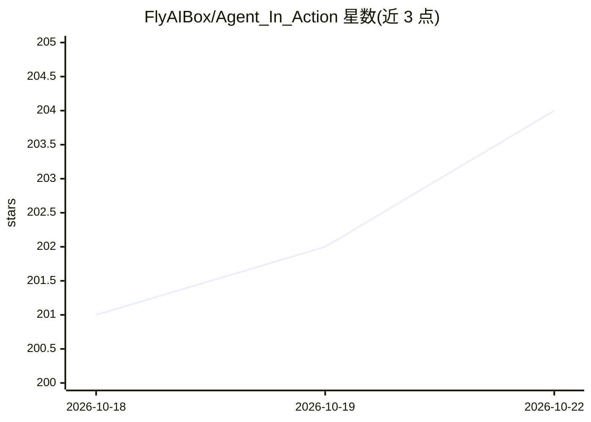

# FlyAIBox/Agent_In_Action

⭐ 204 · Jupyter Notebook · MIT · 推送 2026-01-23 · [GitHub](https://github.com/FlyAIBox/Agent_In_Action) · [官网](https://u.geekbang.org/subject/intro/1010961&utm_source=jksj-AgenticAI-jksjznty-1124&utm_content=jksj-AgenticAI-jksjznty-1124&utm_term=jksj-AgenticAI-jksjznty-1124?utm_term=pc_interstitial_2063) · 个人维护 · 中文 README

**面向中高级学习者的企业级 AI 智能体实战课程（6 个项目）**

一套中文智能体开发实战课程，含 6 个完整可运行项目：MCP 工具集成（和风天气）、从零基于 GAME 架构构建智能体、LangGraph 深度研究助手、多角色旅行规划系统（FastAPI+Streamlit+Docker）、Langfuse 监控评估、LlamaFactory+LoRA+vLLM 医疗领域微调。面向 AI 工程师、后端开发者、算法工程师与技术 Leader，提供课程大纲、学习路径、环境搭建指南（含预配置虚拟机镜像与手动安装）及各项目 API 密钥配置说明。项目 6 微调需 NVIDIA GPU 80GB+ 显存。

## 筛选速览

| 维度 | 判定 | 备注 |
|---|---|---|
| AI 角色 | `ai-knowledge` | 知识聚合/清单类 |
| 许可风险 | `permissive` | MIT |
| 部署形态 | `self-host` | docker 或自建部署 |
| 模型依赖 | local-ok | 支持本地模型 |
| 硬件要求 | `gpu-24g` | |
| 安装摩擦 | `low` | 无编译、无系统依赖或容器化 |
| 成熟度 | — | 结构信号不足 |

## 能力要点

- 6 个完整可运行项目覆盖 MCP、LangGraph、监控评估、LoRA 微调与 vLLM 推理
- 提供预配置虚拟机镜像（OVF）与 Conda 手动安装两种环境搭建方式
- 含课程大纲、学习路径建议与能力检查清单
- 技术栈清单列明各依赖版本（langchain/langgraph/vLLM/Langfuse 等）

## 适用场景

- 系统学习从智能体原理到生产部署的全链路开发
- 参考多智能体协作系统的前后端与 Docker 部署实现
- 实践医疗领域 LoRA 微调与 vLLM 推理部署流程

## 场景标签

`教程课程` · 领域:学习与行业

## 证据(README 行号)

> L8: **企业级AI智能体实战课程 · 6个完整项目 · 从底层原理到生产部署**
> L16: **面向大模型智能体中高级学习者的系统化实战课程**，通过6个完整的企业级项目，掌握从底层原理到生产部署的全链路技能。本课程不是入门教程，而是帮助你构建**可落地、可扩展、可维护**的智能体系统。

## 星数曲线

2026-10-18 201 → 2026-10-22 204（+3）

---
*卡片 v1 · prompt 1.4 · 生成 2026-10-22 · 置信度 high · 依据 README sha `4e776c784940` · [字段定义](../../DATASET.md)*
