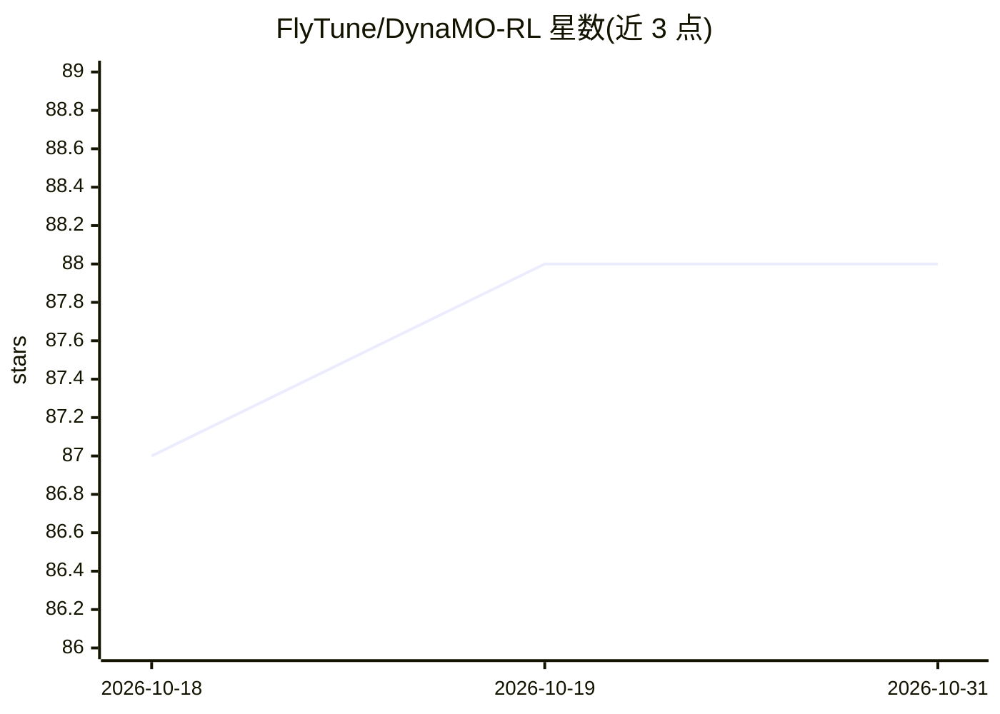

# FlyTune/DynaMO-RL

⭐ 88 · Python · Apache-2.0 · 推送 2026-04-11 · [GitHub](https://github.com/FlyTune/DynaMO-RL) · 组织维护

**RLVR 训练算法 DynaMO 官方实现：动态 rollout 分配+优势调制**

论文官方实现，基于 verl 框架。面向使用可验证奖励强化学习（RLVR）训练 LLM 数学推理能力的研究者。两个机制：序列级按梯度方差最小化原则为各问题动态分配 rollout 数量（以伯努利方差为可计算代理）；token 级引入梯度感知的优势调制因子，补偿高置信正确动作的梯度衰减，并以熵变化为指标抑制过大更新。在六个数学基准、1.5B/7B/14B 规模上与 GRPO 等基线对比。安装需先装 verl，运行靠示例脚本，许可证沿用 verl。

## 筛选速览

| 维度 | 判定 | 备注 |
|---|---|---|
| AI 角色 | `ai-ecosystem` | LLM/agent 周边工具 |
| 许可风险 | `permissive` | Apache-2.0 |
| 部署形态 | `library` | 以包/库形式分发 |
| 模型依赖 | — | README 未给出锁定关系 |
| 硬件要求 | — | 无带数字的原话,不猜 |
| 安装摩擦 | `low` | 无编译、无系统依赖或容器化 |
| 成熟度 | — | 结构信号不足 |

## 能力要点

- 方差最小化的动态 rollout 分配（伯努利方差代理梯度信息量）
- 梯度感知优势调制：熵感知补偿因子 + 基于熵变化的稳定因子
- 基于 verl 框架实现，提供 Qwen2.5-Math-7B 训练示例脚本

## 适用场景

- RLVR 训练中按问题难度差异分配 rollout 计算
- 缓解高置信正确动作的梯度衰减并稳定更新幅度
- 复现论文中六个数学推理基准的对比实验

## 场景标签

`强化学习` · 领域:训练与推理

## 证据(README 行号)

> L16: Reinforcement Learning with Verifiable Rewards (RLVR) has proven effective for Large Language Model (LLM) reasoning
> L35: This implementation is based on verl, a flexible and efficient RLHF framework. Please follow the verl installation 

## 星数曲线

2026-10-18 87 → 2026-10-31 88（+1）

---
*卡片 v1 · prompt 1.4 · 生成 2026-10-23 · 置信度 mid · 依据 README sha `d621825bf4a2` · [字段定义](../../DATASET.md)*
