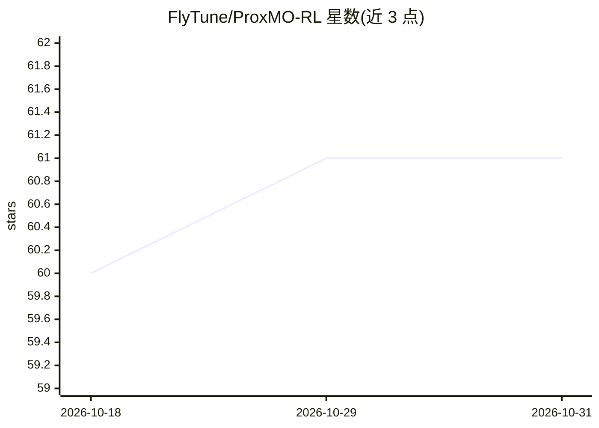

# FlyTune/ProxMO-RL

⭐ 61 · Python · Apache-2.0 · 推送 2026-03-29 · [GitHub](https://github.com/FlyTune/ProxMO-RL) · 组织维护

**面向 LLM 智能体训练的多轮 RL 信用分配方法官方实现**

ProxMO 论文（arXiv:2602.19225）的官方实现，基于 verl 框架构建，用于多轮 LLM 智能体的强化学习训练。方法包含两个机制：回合级的成功率感知调制（按经验成功率 p 调整梯度强度）与步级的基于 TF-IDF 相似度的软聚合基线估计，可与 GRPO 流程结合使用且不引入额外网络。README 报告在 ALFWorld 与 WebShop 两个基准、Qwen2.5-1.5B/7B 两个规模上的实验结果与消融研究。安装依赖 conda 与 pip，另需单独安装 ALFWorld/WebShop 环境（WebShop 要求 Python ≤3.10）。

## 筛选速览

| 维度 | 判定 | 备注 |
|---|---|---|
| AI 角色 | `ai-ecosystem` | LLM/agent 周边工具 |
| 许可风险 | `permissive` | Apache-2.0 |
| 部署形态 | `library` | 以包/库形式分发 |
| 模型依赖 | — | README 未给出锁定关系 |
| 硬件要求 | — | 无带数字的原话,不猜 |
| 安装摩擦 | `low` | 无编译、无系统依赖或容器化 |
| 成熟度 | — | 结构信号不足 |

## 能力要点

- 回合级成功率感知调制 + 步级 TF-IDF 邻近软聚合的两级信用分配
- README 报告 +1.09% 开销、无需额外网络、可接入 GRPO 流程
- 在 ALFWorld 与 WebShop 基准、1.5B/7B 两个规模上报告实验与消融
- 基于 verl 框架，提供示例训练脚本

## 适用场景

- 在 ALFWorld/WebShop 类多轮任务上做 LLM 智能体 RL 训练
- 研究多轮强化学习中的信用分配方法并复现论文实验
- 在现有 GRPO 训练流程中加入步级/回合级优势估计变体

## 场景标签

`强化学习` · 领域:训练与推理

## 证据(README 行号)

> L8:  <a href="https://github.com/verl-project/verl">
> L20: ProxMO is a **lightweight, practical framework** for multi-turn LLM agent training that addresses a fundamental cha
> L52: ProxMO addresses a fundamental challenge in multi-turn LLM agent training: **context-dependent credit assignment**.

## 星数曲线

2026-10-18 60 → 2026-10-31 61（+1）

---
*卡片 v1 · prompt 1.4 · 生成 2026-10-24 · 置信度 high · 依据 README sha `f10fd3bde213` · [字段定义](../../DATASET.md)*
