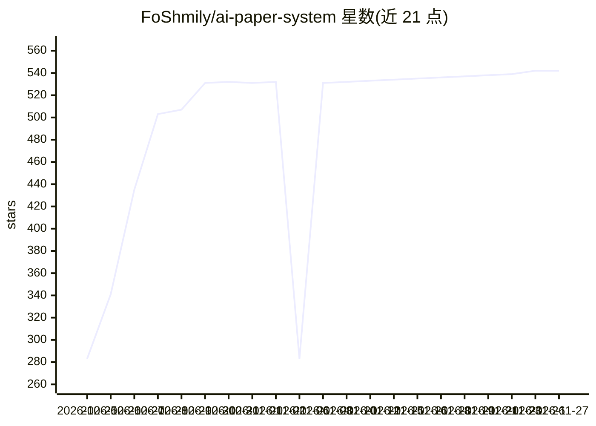

# FoShmily/ai-paper-system

⭐ 542 · 推送 2026-11-26 · [GitHub](https://github.com/FoShmily/ai-paper-system) · [官网](https://www.openlun.com) · 个人维护 · 中文 README

**面向教培/商户的AI论文写作SaaS白标系统**

一套提供论文写作全链路的 Web 系统：智能写作（任务书、开题报告、文献综述、本硕/专科论文）、AI 无限改稿、格式排版、降重/降 AIGC、AIGC 检测、答辩 PPT 生成，以及科研绘图、公式识别、全文翻译、AI 问卷等工具箱。README 未给出自行部署的技术文档，部署通过联系客服的 OEM 合作方式完成，配套会员、充值套餐、订单与使用记录等运营功能。目标用户为教育培训机构、流量主、创业者等希望自有品牌上线 AI 学术写作业务的商户。

## 筛选速览

| 维度 | 判定 | 备注 |
|---|---|---|
| AI 角色 | `ai-native` | 本体是模型或模型工具 |
| 许可风险 | `none` | — |
| 部署形态 | `None` |  |
| 模型依赖 | — | README 未给出锁定关系 |
| 硬件要求 | — | 无带数字的原话,不猜 |
| 安装摩擦 | `low` | 无编译、无系统依赖或容器化 |
| 成熟度 | — | 结构信号不足 |

## 能力要点

- 覆盖开题、写作、改稿、排版、降重、检测、答辩 PPT 的写作链路
- OEM 白标与 SAAS/独立部署方案，支持自定义品牌与定价
- 会员体系、充值套餐、订单与使用日志追踪
- 科研工具箱：科研绘图、公式识别、全文翻译、AI 问卷

## 适用场景

- 教培机构以自有品牌上线 AI 论文写作服务
- 代理商/流量主开展论文写作相关业务并按套餐定价
- 学生在线完成开题报告、文献综述与论文初稿写作

## 场景标签

`AI 写作` · 领域:内容生成

## 证据(README 行号)

> L91: - 支持 **智能写作全链路**：开题报告、任务书、文献综述、本硕/专科/课程论文、范文仿写
> L132: ### 💥💥💥 OEM / 商户合作加盟

## 星数曲线

2026-10-25 283 → 2026-11-27 542（+259）

---
*卡片 v1 · prompt 1.4 · 生成 2026-11-27 · 置信度 mid · 依据 README sha `129b89358292` · [字段定义](../../DATASET.md)*
