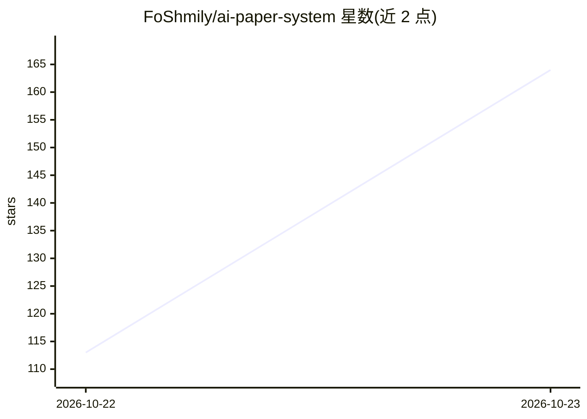

# FoShmily/ai-paper-system

⭐ 164 · 推送 2026-10-13 · [GitHub](https://github.com/FoShmily/ai-paper-system) · [官网](https://www.openlun.com) · 组织维护 · 中文 README

**面向机构加盟的 AI 论文写作 SAAS 系统（OEM 白标）**

AI 学术写作商业系统「学成写作」的推广仓库：功能覆盖开题报告、文献综述、论文写作、AI 无限改稿、格式排版、降重/降 AIGC、AIGC 检测、答辩 PPT 生成及科研工具箱（绘图、公式识别、翻译、问卷）。商业模式以 OEM 白标与商户加盟为主，通过客服微信联系部署，无公开源代码、无安装命令，仅提供在线体验地址 openlun.com 与系统截图。README 以营销与招商内容为主。

## 筛选速览

| 维度 | 判定 | 备注 |
|---|---|---|
| AI 角色 | `ai-native` | 本体是模型或模型工具 |
| 许可风险 | `none` | — |
| 部署形态 | `None` |  |
| 模型依赖 | — | README 未给出锁定关系 |
| 硬件要求 | — | 无带数字的原话,不猜 |
| 安装摩擦 | `low` | 无编译、无系统依赖或容器化 |
| 成熟度 | — | 结构信号不足 |

## 能力要点

- 写作全链路：开题报告/文献综述/本硕与专科论文/范文仿写
- AI 无限改稿 + 格式排版 + 降重降 AIGC + AIGC 检测
- AI 答辩 PPT 生成与在线编辑，科研工具箱（绘图/公式识别/翻译/问卷）
- OEM 白标与商户加盟模式，SAAS 或独立部署，含会员/套餐/订单体系

## 适用场景

- 教培机构或流量主以自有品牌运营 AI 论文写作服务
- 学生用户完成论文写作、改稿、排版与答辩 PPT
- 代理商开展论文写作业务并管理用户与订单

## 场景标签

`AI 写作` · 领域:内容生成

## 证据(README 行号)

> L2:  AI论文生成、AI论文写作，一键论文生成 · 开题报告 / 文献综述 / 无限改稿 / 格式排版 / 降重降AIGC / 答辩PPT / 科研工具
> L91: - 支持 **智能写作全链路**：开题报告、任务书、文献综述、本硕/专科/课程论文、范文仿写
> L96: - 支持 **AI 答辩 PPT** 一键生成与在线编辑

## 星数曲线

2026-10-22 113 → 2026-10-23 164（+51）

---
*卡片 v1 · prompt 1.4 · 生成 2026-10-23 · 置信度 high · 依据 README sha `1af27384701c` · [字段定义](../../DATASET.md)*
