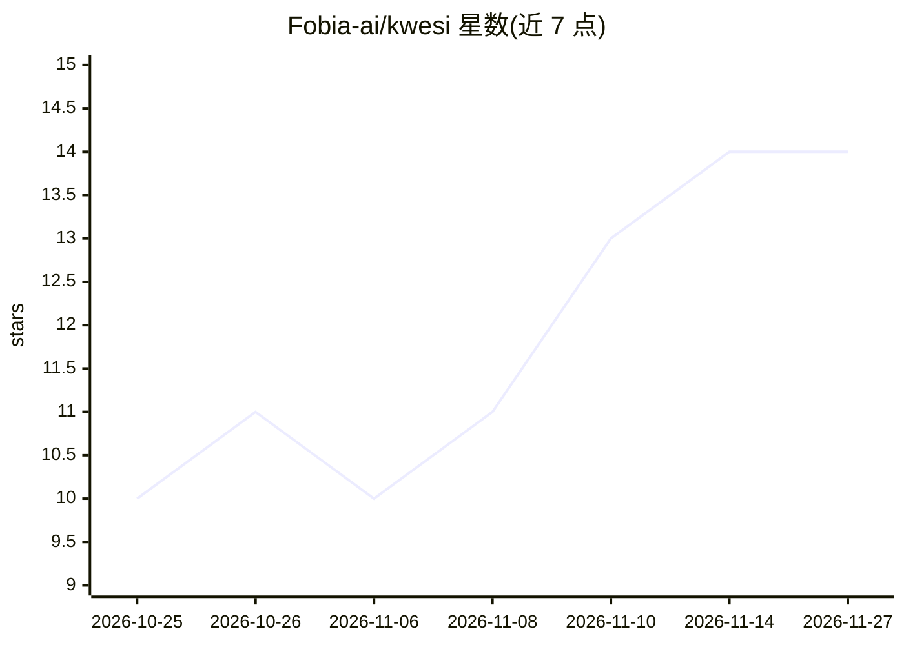

# Fobia-ai/kwesi

⭐ 14 · TypeScript · 推送 2026-10-07 · [GitHub](https://github.com/Fobia-ai/kwesi) · 个人维护

**本地运行开源 AI 模型生成与训练音乐的桌面应用**

Kwesi 是一个 local-first 桌面应用，将 MusicGen、MuseCoco、ACE-Step 1.5、RAVE、Museformer、YuE2 六个开源音乐生成模型封装在统一界面之后，全部在本地运行，无账号与云上传。内置 Model Manager 浏览、下载权重并自动创建每个模型隔离的 Python venv（因依赖版本互不兼容）；支持用用户自己的音频/MIDI 数据微调四个模型，内置播放器、MIDI 钢琴卷帘与 ABC 记谱查看器。基于 Electron + React + Python sidecar 服务器；Linux 为已验证打包平台，macOS/Windows 仅为配置。

## 筛选速览

| 维度 | 判定 | 备注 |
|---|---|---|
| AI 角色 | `ai-native` | 本体是模型或模型工具 |
| 许可风险 | `none` | — |
| 部署形态 | `library` | 以包/库形式分发 |
| 模型依赖 | — | README 未给出锁定关系 |
| 硬件要求 | `cpu-ok` | |
| 安装摩擦 | `low` | 无编译、无系统依赖或容器化 |
| 成熟度 | — | 结构信号不足 |

## 能力要点

- 六个开源音乐模型统一封装，界面按模型输入/输出动态重构
- 应用内下载权重并为每个模型创建隔离 Python 虚拟环境
- 支持 RAVE/MusicGen/ACE-Step/MuseCoco 用本地数据训练自有 checkpoint
- 内置音频播放、导出与 MIDI 钢琴卷帘/ABC 记谱查看器

## 适用场景

- 在本地无网络环境下用文本或 MIDI 生成音乐
- 用自己的音频或 MIDI 文件微调出专属音色模型
- 查看与导出生成曲目的钢琴卷帘和乐谱表示

## 场景标签

`微调` · 领域:训练与推理

## 证据(README 行号)

> L5: A local-first desktop app for generating and training music with open-source AI models. Everything runs on your own 
> L89: |Model|What it does|Inputs|Outputs|License|Verified?|
> L95: |**Museformer** (Microsoft)|Symbolic music continuation|Random generation or MIDI seed|MIDI|MIT|Inference verified 

## 星数曲线

2026-10-25 10 → 2026-11-27 14（+4）

---
*卡片 v1 · prompt 1.4 · 生成 2026-11-18 · 置信度 mid · 依据 README sha `b0a3a25cf8a0` · [字段定义](../../DATASET.md)*
