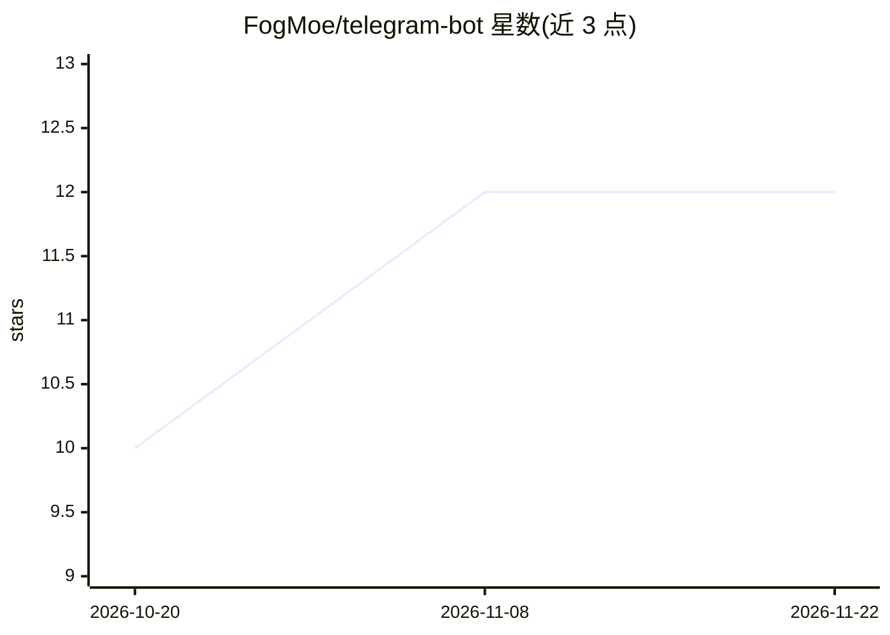

# FogMoe/telegram-bot

⭐ 12 · Python · AGPL-3.0 · 推送 2026-11-16 · [GitHub](https://github.com/FogMoe/telegram-bot) · [官网](https://t.me/FogMoeBot) · 个人维护 · 中文 README

**面向 Telegram 群组的多功能机器人：AI 对话、积分、游戏与管理**

以 Python 3.13 编写的 Telegram 机器人，功能覆盖 AI 对话（经 LiteLLM 接入多个 provider 并按优先级回退）、社区积分体系、娱乐小游戏、群组管理与中英互译等实用工具。AI 支持图片理解、图片/语音生成、网页读取、Python 执行与沙箱工具调用。运行需外部 MySQL 8.0 数据库，通过 uv 或 Docker Compose 部署，采用 AGPL-3.0 许可证。部分 AI 扩展能力需另行配置第三方服务，未配置时不影响基础功能。

## 筛选速览

| 维度 | 判定 | 备注 |
|---|---|---|
| AI 角色 | `ai-enhanced` | 去掉 AI 部分产品仍成立 |
| 许可风险 | `viral` | AGPL-3.0 |
| 部署形态 | `self-host` | docker 或自建部署 |
| 模型依赖 | — | README 未给出锁定关系 |
| 硬件要求 | — | 无带数字的原话,不猜 |
| 安装摩擦 | `low` | 无编译、无系统依赖或容器化 |
| 成熟度 | — | 结构信号不足 |

## 能力要点

- 多模型路由：经 LiteLLM 接入 OpenAI、Gemini、Azure OpenAI、智谱 AI、SiliconFlow，按优先级自动回退
- 图片理解、图片/语音生成等多模态能力，支持搜索与隔离沙箱等工具调用
- 积分签到、虚拟商城、排行榜等社区体系，与 AI 好感度联动
- 新成员九宫格验证、垃圾消息检测与举报审核等群组管理功能

## 适用场景

- 为 Telegram 群组提供 AI 对话与智能回复
- 运营社区积分签到、商城与排行榜
- 自动验证新成员并检测垃圾信息
- 在群里玩御神签、骰子、RPG 等小游戏

## 场景标签

`聊天机器人` · 领域:对话与助手

## 证据(README 行号)

> L8: 集 AI 助手、社区积分、娱乐互动和群组管理于一体的 Telegram 机器人。
> L16: - **多模型路由**：通过 LiteLLM 接入 OpenAI、Google Gemini、Azure OpenAI、智谱 AI（Z.ai）和 SiliconFlow，可按优先级自动切换备用服务。
> L75: - MySQL 8.0 或更高版本

## 星数曲线

2026-10-20 10 → 2026-11-22 12（+2）

---
*卡片 v1 · prompt 1.4 · 生成 2026-11-18 · 置信度 mid · 依据 README sha `92698da3a719` · [字段定义](../../DATASET.md)*
